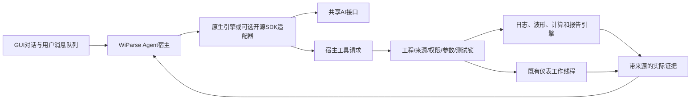

# WiParse AI：开源 Agent 集成与智能性、性能、Token 评估

日期：2026-11-10。基于当前 Rust/egui、原生仪表工作线程、共享 AI 接口、Node.js 测试插件架构。本文区分已实施、候选方案和未完成验收，不把调研等同于已集成。

## 结论与选型

可以集成开源 Agent SDK，但要选取运行循环、上下文管理、流程编排等明确层次，保留 WiParse 的数据处理和设备执行边界。框架不能代替模型的推理能力、产品知识、协议解码器和有标准答案的评测，也不自动保证省 Token。

建议先在相同工具契约和评测集上比较 **Rig 的 Rust 库**与 **Pi 的 Agent 核心库**；需要跨进程长任务及可恢复工作流时，再比较 **LangGraph.js**。生产默认路径先使用本轮已经修正的原生运行引擎。当前没有安装或切换外部 Agent 运行时，没有额外引入 Python、Docker 或云端编排服务。

|候选|上游能力与许可资料|与WiParse的适配判断|决策|
|---|---|---|---|
|Rig库|Rust LLM库，支持工具、多轮流式和类型化hooks；仓库标注MIT。[库说明](https://github.com/0xPlaygrounds/rig#the-library)、[仓库](https://github.com/0xPlaygrounds/rig)|与现有Rust类型和主机工具边界接近；要验证Windows目标、取消、API兼容、依赖体积和升级成本。其编码CLI与库是不同交付物，不能把CLI支持当作本软件Windows验收|Rust原生SDK优先PoC；不复制整套编码CLI|
|Pi Agent核心|状态化Agent、事件流、上下文转换，以及steering/follow-up队列；当前官方仓库为earendil-works/pi，标注MIT。[核心文档](https://raw.githubusercontent.com/earendil-works/pi/main/packages/agent/README.md)、[仓库](https://github.com/earendil-works/pi)|适合可选Node进程；WiParse已有Node插件基础，但仍需锁定SDK及运行时版本、RPC和进程退出语义。不能照旧教程假设包名和API一直不变|轻量Agent循环/事件队列候选；不接入默认文件和shell工具|
|LangGraph.js|图工作流、checkpointer和store；核心库MIT。[持久化说明](https://docs.langchain.com/oss/javascript/langgraph/persistence)、[核心许可](https://github.com/langchain-ai/langgraphjs/blob/main/libs/langgraph-core/LICENSE)|适合较长测试流程、暂停/恢复和可观测节点；Node侧编排仍调用Rust宿主。SDK与托管服务是不同部署选择，不必为SDK引入托管服务|长任务编排候选，不用它代替实时采集或仪表驱动|
|PydanticAI|Python类型化Agent、用量限制及可恢复执行适配；仓库标注MIT。[仓库](https://github.com/pydantic/pydantic-ai)、[生产限制说明](https://pydantic.dev/docs/ai/production/)|类型验证与评测思路有价值；当前发行不依赖Python运行时，直接采用会增加分发及环境兼容工作|现阶段不作为默认桌面运行时；可用于独立离线评测|

以上是工程判断，不是框架之间实测的速度或成功率排名。没有安装测试，因此不列虚构的内存、包体和“省Token百分比”。实际采用时必须固定发布版本和完整依赖清单，保留相应许可文件。

## 当前问题及本轮修正

详细逐项审查见[智能性评审](ai-agent-intelligence-review-2026-11-10.md)。当前的关键问题不在“缺一个框架名字”，而在以下执行与上下文设计：

1. **目标状态薄弱。** 原来没有带实际证据约束的子目标，模型容易遗漏功率、周期、协议或报告中的一项。本轮增加 `agent.plan`，保留待处理/处理中/完成/阻塞状态，完成时检查实际证据，不能无声删除未解决目标。
2. **证据易遗忘。** 原生历史压缩后只剩少量结果。本轮增加有界证据账本、精简索引和 `agent.evidence` 按ID召回；早期证据不必重新扫文件，来源变化也不会自动被当成当前数据。
3. **工具组合被误拒绝。** 串口入口过去只接受一个原生函数调用。本轮支持最多4个独立只读调用，宿主顺序执行并按各自tool_call_id归还所有结果；不把设备动作放入自动批处理。
4. **无条件扫描浪费。** 原来连能力说明也先扫描整个日志。本轮改为按目标取证；简单解释直接回答，复杂任务主动调用本地引擎，无需用户逐次确认。
5. **无关参数常驻。** 原来每轮都附整套计算器字段。本轮用当前页工作指引和 `agent.help` 按需补充，避免把所有领域的详细参数放进每一轮。
6. **请求前缀不稳定。** 原来不断变化的观察数据插在历史工具消息之前。本轮固定本任务初始请求和历史，把最新宿主状态放到工具历史之后；维持同一任务内可复用的消息前缀。
7. **缺少真实用量反馈。** 本轮记录服务返回的输入、输出、缓存Token及用量报告覆盖；缺失字段显示未知，不宣称零成本。串口同时显示当前任务与本会话累计用量。
8. **交互阻塞。** 本轮新增用户消息FIFO，任务进行中可继续提交；来源或权限变化有独立处理，不把未发送消息误当成设备操作授权。

计划完成约束只验证模型已声明的目标与工具证据类别，不能形式化证明任意自然语言需求都已经满足。普通问题不强制创建计划。分析/报告可以引用真实失败结果解释问题；曲线、计算和操作不能把失败结果当成成功证据。

## 集成边界

框架适配器只能规划和请求工具，不能绕过宿主直接访问串口、VISA、DAP、任意目录或凭据。API Key继续由共享接口管理；Node/Python候选可通过宿主模型代理调用，不必另存密钥。适配器只处理 `task.start/cancel`、模型请求、工具请求、工具结果、状态及完成事件，不建立第二套设备连接。

可恢复流程需要明确区分“尚未发送”“已发送未确认”“已确认完成”。只恢复图状态不足以证明物理动作没有发生。上游也明确要求处理幂等与缺失确认，不能把恢复等同于重试。[LangGraph故障恢复说明](https://docs.langchain.com/oss/javascript/langgraph/fault-tolerance)。真正的设备恢复还需WiParse持久化命令身份和查询结果，当前内存账本不提供跨进程恢复保证。

## Token与性能措施的收益边界

|措施|可改善的内容|需要测量的限制|
|---|---|---|
|本地全文扫描、统计、事件和时序提取|减少上传的原始日志与模型计算|仍需原始数据本地I/O；覆盖不全必须标注|
|精简索引、按ID召回|减少重复明细、减少无进展查询|召回本身可能增加一次模型工具轮次，要比较整项任务|
|按需参数帮助、页面指引|减少无关规则、降低参数猜错|增加管理工具也占Schema额度，不能只看提示词片段|
|稳定前缀与成对工具历史|让重复前缀具备缓存条件|服务是否命中、账单是否优惠取决于模型、服务与缓存状态|
|一个模型轮次提出多个只读请求|减少模型往返等待|宿主仍顺序执行；不声称设备并发提高4倍|
|避免给简单问题扫描/规划|缩短首答路径，减少无关取证|复杂任务仍应充分验证，不能为减少Token省掉必要证据|
|宿主完成检查|发现遗漏，降低反复人工推动|计划和纠正可能增加部分任务的Token，质量与总成本应一起评估|

DeepSeek返回缓存命中相关usage字段；千问有基于公共前缀的缓存机制。缓存可能降低重复计算和相应计费，但不会让输入Token总数自动变小，也不能由客户端保证命中。[DeepSeek缓存](https://api-docs.deepseek.com/guides/kv_cache/)、[千问缓存](https://help.aliyun.com/en/model-studio/context-cache)。本轮不硬编码各模型价格、不根据字节数伪算Token节省率，不自动提高已保存的输出额度。

“多Agent互评”“每次先让另一个模型规划”“每次自动生成长摘要”都可能增加模型调用。默认不启用这些通路。确有收益的专业复核，可在评测证明必要时选择性使用。

## 专业知识与能力仍需建设

- **统一工具注册：** 串口与通用助手已共享计划/证据组件，执行适配器和工具覆盖尚未完全统一。例如部分波形时序、测试配置/运行和报告动作仍主要位于通用入口。SDK接入应通过统一注册与按Effect授权的宿主适配器，不能宣称串口入口已经能做所有平台操作。
- **交互与总预算：** 当前原生工具请求在完整响应后呈现，逐字流式事件仍需专门适配。当前任务按调用数和时限限额，输出Token上限不等于跨请求累计预算；新增usage是后续累计Token/费用限制及实测对比的基础。
- **产品知识检索：** 对用户选定的规格、寄存器表、协议说明、历史问题和测试判据建立版本化索引。可先评估复用现有SQLite进行本地全文检索；向量化不是必选项，不能未经评测上传全部工程文件做embedding。
- **领域证据：** 充电状态码、单位、阈值和协议含义必须来自当前证据或明确版本的资料。框架不会自动知道私有固件语义，不能将关键词报警数当作断充次数或错误率。
- **多模态：** 当前文本分析不等于能读截图像素。若增加视觉，需要图像权限、来源标识、大小控制和服务兼容；仍优先用原始波形测量做定量判断。
- **跨重启恢复与正式报告归档：** 当前任务/队列和证据账本在内存中，报告在对话呈现；这些不是已实现的持久化恢复或自动归档功能。

这些属于后续明确工作项，不能在UI或答复中提前宣称具备。

## 对比验收方法

候选SDK通过同一个工具适配器运行相同任务，保持模型、参数、数据和权限相同，与当前原生引擎A/B比较。单独统计模型推理、网络、本地扫描和仪表等待，不将网络慢归因于GUI或框架CPU。

场景包括：普通问答、全范围日志计数、重复事件归并、指定充电周期、缺字段与单位换算、多只读工具、早期证据召回、遗漏子目标、真实失败诊断、源变化、消息FIFO、控制权限撤销及长任务预算。

指标至少包含：目标覆盖、证据准确度、虚构结论、人工推动次数、动作越权、完成率、输入/输出/缓存Token、无用重复调用、首答和总耗时、峰值内存、包体和恢复一致性。节省目标必须以“正确性不降低”为前提，不预先承诺一个适用于所有任务的比例。

准入顺序：SDK最小适配 → 模拟模型与演示设备契约 → 经授权的真实模型评测 → 独立灰度 → 再决定是否替换默认运行引擎。未验收候选不出现在生产UI中冒充可用选项。

## 本轮交付状态

已实施的是原生任务状态、证据召回、只读批量、上下文顺序、用量统计及串口队列/布局；没有引入外部SDK依赖。完整回归、发布构建和源码校验见 `docs/verification/ai-intelligence-20261110/verification.md`。验证使用本地模拟模型和合成日志，不把该结果等同于真实模型的专业理解成功率。
