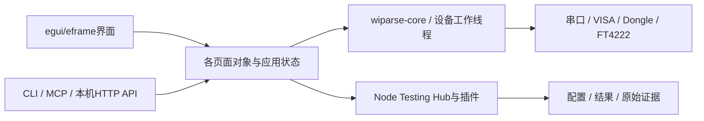
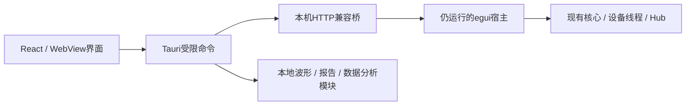

# WiParse GUI框架迁移评审与新旧架构对比

评审日期：2026-11-07。结论：**技术方向成立，当前实现属于已接入真实能力的过渡预览，尚未达到原有版本的完整替代和发布条件。** 当前最主要的进展是建立新的界面层、受限命令桥及部分功能入口；最主要的缺口是应用服务仍与旧GUI耦合，以及功能、设备所有权、安全、性能和桌面验收尚未闭环。

## 1. 范围、基线与证据

本次为当前工作区源码、迁移文档和自动测试评审，不修改业务代码、不部署、不执行物理仪器操作。原版结构以提交`fa62efe`的egui版1.2.2为参照，同时核查当前已修改的egui兼容宿主。必须区分三者：旧版基线、当前兼容宿主、新版Next前端。Next依赖新增加的兼容接口，不能认为仅使用旧版同名1.2.2安装包即可运行全部新功能。

证据索引：

- E01：根`Cargo.toml`仍采用egui/eframe/egui_plot 0.31；旧版`backend/ui.rs:18`的`UiHost`直接持有页面状态和设备面板引用。
- E02：`apps/wiparse-next/package.json`采用React18、TypeScript、Vite、Tauri2；`src-tauri/Cargo.toml`单独声明workspace，并复用`wiparse-core`。
- E03：`src-tauri/src/main.rs:11–80`固定访问127.0.0.1:7878；通用读取白名单、独立写命令、阻塞HTTP置于spawn_blocking；AI接口另取本机DPAPI凭据。
- E04：`src-tauri/src/main.rs:760`附近注册84个Tauri命令，包含读写和硬件控制，已不只是只读原型。命令数量不能换算为功能完成率。
- E05：`crates/wiparse-gui/src/backend/mod.rs:379`附近仅对`ui.ai.*`实施此处Bearer校验；其他旧控制路径不能因Tauri使用白名单而视作已认证。
- E06：`src/deviceInterlock.ts`明确为localStorage恢复标记；`wiparse-core/src/resource_lock.rs`及serial/bridge/dongle/visa接入是另一层真正的资源互斥进展，覆盖程度仍需逐路径验收。
- E07：`src/App.tsx:660–682`附近多个状态轮询按2/5秒更新；兼容响应采用JSON Value/unknown，缺少覆盖全链的统一强类型版本契约。
- E08：`wave_view.rs:7–10`限制64MiB、400万点、32通道、2048桶；报告、数据分析另有本地有界处理模块。
- E09：`tauri.conf.json`设置CSP、1100×720最小窗口，`bundle.active=false`；capabilities限于main窗口/core:default。该配置不等于业务接口鉴权已完成。
- E10：`MIGRATION-STATUS.md`明确多项未迁移或待桌面/实机验证；`ACCEPTANCE-PLAN.md`五轮验收仍未执行。

本轮验证：前端15项测试通过，TypeScript/Vite生产构建通过，Tauri Rust31项测试通过。日志与源码哈希见`../verification/gui-framework-review-2026-11-07/verification.json`。未执行桌面点击、真实截图、实机、长稳及新旧性能对照；不能将这些自动测试计入五轮正式验收。部分文档在终端输出存在编码显示差异，不据此推定源文件已损坏。

## 2. 新旧实际架构

### 2.1 原版：以GUI为应用宿主

优点是设备与页面在同一应用生命周期内，调用链短，已有功能和回归资产丰富。问题是设备服务入口依赖页面状态和GUI线程协调，复用及独立运行困难，页面复杂度与业务复杂度相互放大。已有后台线程不应被忽略，但后台线程存在也不代表服务层已独立。

### 2.2 当前Next：新界面加旧宿主的混合架构

设备操作仍由旧宿主执行；离线文件处理有部分直接复用核心库。该结构有利于逐页迁移和回退，却引入两套窗口/状态、HTTP序列化、接口版本和生命周期协调。它不是已经完成的“React→独立Rust设备服务”。

### 2.3 目标：单一权威应用服务

目标应是React只负责显示与输入，Tauri负责桌面能力和受控桥接，统一Rust应用服务负责会话、作业、采集、恢复和测试编排，旧GUI可作为可退回的客户端。服务可以嵌入Tauri进程或独立运行，必须通过验证选型；重要的是只有一个权威设备所有者，而不是先决定进程数量。现有`wiparse-service`有独立自动化能力，但不能假定已覆盖全部GUI仪器和Hub功能。

## 3. 新旧优缺点对比

|维度|原egui版本|当前Next过渡版|最终新架构的潜力与代价|
|---|---|---|---|
|界面排版|原生绘制、统一Rust技术栈；复杂表单与长文本需手写布局|CSS网格、组件、Markdown和虚拟列表已有落地；视觉质量尚未桌面验收|更易统一对齐、层级、响应式和可访问名称；仍需组件规范和交互测试，换框架不会自动变美观|
|功能完整性|已有完整业务链和较多历史回归资产|覆盖多页面但仍有明确缺项；新UI不等于旧能力已迁移|可逐步恢复全部功能；迁移期存在回退及双实现维护成本|
|设备生命周期|同一GUI承载，路径较短；状态与页面耦合|设备仍归旧宿主，本地标记只保护当前WebView部分操作|统一会话服务可约束所有入口；需真正覆盖驱动、别名和异常恢复|
|响应与资源|避免WebView/DOM及跨进程JSON；复杂页面重绘和大任务可能拖慢GUI|有后台读取、延迟加载和降采样；额外增加WebView、旧GUI、IPC及轮询|合理的数据平面有改善空间；没有基准前不能声称更省内存或更流畅|
|日志与波形|原功能较完整，已有大数据优化|串口分页、分批搜索、波形桶视图是正向进展；容量和功能收窄|需要原始数据留在Rust，按视口获取；DOM/JSON传输不适合完整高频数据反复搬运|
|安全边界|原本机API存在未认证控制路径|CSP、命令限制、AI凭据保护和参数校验增强了新入口；旧入口仍可独立访问|需统一服务端身份、权限、资源范围、命令去重及状态查询；本机地址和safe命名不等于鉴权|
|配置与追溯|既有项目、配置快照、版本哈希、证据链较成熟|部分路径复用版本/哈希冲突检查；编辑覆盖不完整，部分缓存仅在进程内|统一应用模型可消除两个界面间的状态漂移；必须验证原配置往返和迁移回退|
|开发维护|单Rust栈，跨层问题少；页面体量大、业务耦合重|前端便于组件化，但App.tsx与Tauri main.rs再次聚合大量功能|按领域拆模块后更易测试；代价是Rust/TS/Node及两套构建依赖管理|
|部署|现有便携包及符号、驱动说明可复用|新工程独立workspace、应用版本0.1.0；打包关闭；WebView2方案未验收|需锁定WebView2、Node、VC++与驱动条件，兼容离线、升级及回滚|
|稳定性证据|已有旧版测试和现场使用，仍有硬件边界|新增自动测试有效，但不能继承旧版全部现场结论|需用同一数据集和同一仪器进行对照，验证完整流程及多故障场景|

综合判断：**新架构的主要收益是界面开发与服务分层的长期可维护性；当前最显著的代价是双宿主复杂度和迁移缺口。性能、安全和可靠性收益均需后续实现与测量。**

## 4. 当前迁移进展

|领域|已实现或接入|主要缺口|当前判定|
|---|---|---|---|
|外壳与布局|Tauri外壳、CSS变量、工具栏、工作区和面板拆分|深浅主题、中英文、DPI及完整桌面交互验收；当前CSS以浅色与中文为主|框架建立，视觉验收未完成|
|工程与Hub|工程读取/新建/切换、矩阵虚拟列表、快照校验、部分预检/运行/停止|完整工程树、配置导入导出、暂停恢复与历史操作逐项等价性|部分业务可用，不是完整替代|
|FPGA|部分测试项/工程角色/固件选择/规则和采集编辑|其余规则类型、完整表单往返、全流程桌面与实机|配置编辑为部分迁移；固件下载仍预留|
|普通插件/监控插件|参数表单、生命周期、文本触发条件、部分JSON导入导出|专用控件、复杂规则、完整配置持久化及真实抓取|模拟验证，未逐插件桌面验收|
|串口|状态/分页/筛选/分批查找、文件打开关闭、受限启停发送、主口文本记录|附加口记录、原始字节一致性、断线恢复、吞吐、大日志和完整操作体验|有真实接口和测试，但仍有重要缺口|
|仪器|扫描连接、部分示波器/电源/负载控制、任务确认、截图和源波形入口|其他设备、完整控制项、跨入口所有权、实际读回和断线恢复|受限能力接入，实机未验收|
|波形|核心解析、桶视图、双游标、有限叠加、原始点CSV导出|完整协议分析/测量/导出、超过当前上限的数据和性能|离线子集实现，不能替换原波形工具|
|报告|受限文本/Markdown/图片预览、工程结果索引|完整生成与附件导航、旧报告闭环、大项目性能|展示子集实现|
|数据分析与计算器|离线提取/范围统计/CSV，部分原计算复用|实时数据、完整交互/图形和所有导出|部分迁移|
|AI与设置|配置和密钥受限接口、固定短句连接测试、显式确认的单次提问|原串口AI多轮会话、自动分析预警/工具链和其他设置的完整等价迁移|隐私边界有改进，但核心场景存在功能回退|
|资源互斥|核心文件锁及部分COM/VISA/Dongle/FT4222接入与自动测试|所有设备路径、地址别名和新旧入口交接的完整证明|有底层进展，不能只用localStorage宣称完成|

不提供总体完成百分比：目前缺少按原版可执行用例逐项对应的清单与验收分母，按页面数、命令数或截图数计算会夸大进展。

## 5. 问题清单、影响及建议

|编号/优先级|问题与证据|影响|建议及验收条件|
|---|---|---|---|
|G01/P0|非AI控制API未统一鉴权，E05；新壳白名单无法约束其他调用者|控制权限边界不完整|统一宿主/应用服务对所有写命令的鉴权；跨进程、无凭据、过期凭据和日志注入拒绝测试。改动需兼容CLI/MCP/插件|
|G02/P0|设备仍依赖旧GUI对象，E01–03；恢复标记不是跨进程锁，E06|后台故障、双入口和地址别名下的所有权与恢复仍不完整|先列会话所有权矩阵，再逐类设备验证唯一所有者、超时取消、重连、未知状态及进程退出释放；不能只扩前端提示|
|G03/P0发布门禁|AI自动监控、完整波形协议、配置和报告等核心场景未等价迁移|切换新版将丢失用户已有工作能力|以原版场景建立追踪表；关键场景逐项通过后才能替换，否则保留旧版为主版本|
|G04/P1|固定127.0.0.1:7878，缺少覆盖全桥的版本/能力协商；宿主仍标1.2.2，E03|同名版本的旧宿主可能缺命令；端口变化时无法连接，错误易混淆|增加兼容协议版本、能力发现、实例标识、可配置受限端点与明确不兼容提示；不能仅以主版本相同判定兼容|
|G05/P1|多处轮询与跨层JSON，E07；无同负载性能对比|状态滞后、序列化成本、数据拷贝和双进程资源增加|先测空闲/串口高负载/大日志/波形/500矩阵，再按瓶颈引入游标和增量事件、统一缓存及背压；测UI可见延迟而非只测HTTP耗时|
|G06/P1|恢复信息分散在前端localStorage及宿主任务状态|清理WebView数据、不同客户端或崩溃后可能丢失操作上下文|权威恢复状态写到服务侧，前端仅展示和确认；未知完成状态禁止盲目重试|
|G07/P1|协议广泛使用Value/unknown及字符串错误，E03/E07|接口漂移不易在编译期发现，无法稳定区分拒绝/排队/失败/未知|按领域定义版本化DTO和错误枚举；区分command_id、job_id、session_epoch、实际完成与状态未知|
|G08/P1|新工程为独立workspace，E02；打包关闭，E09|根workspace回归可能漏掉Next；历史便携包不能证明Next可交付|CI显式执行两套Rust工作区和前端测试；单独冻结Next/宿主/插件版本及哈希，验证WebView2离线分发、安装、升级、回退|
|G09/P1|旧计划仍写“尚未实施”，README/REVIEW仍描述只读原型，而源码有84个命令，E04|职责、危险操作范围及完成进度被低估|统一计划/迁移状态/接口目录/发布说明，按命令区分读取、保存、设备操作和证据；验收记录独立保存|
|G10/P1|没有本轮桌面视觉/E2E/实机/性能证据，E10|不能保证布局整齐、完整工作流稳定，不能声称比原版快|遵循现有五轮验收，分别产出功能、UI、设备异常、性能和交付报告；阶段单测不计作验收轮次|
|G11/P2|App.tsx和Tauri main.rs集中多领域状态与命令|重构后再次形成入口大文件，新增功能耦合增加|拆分serial/instrument/testing/project/ai领域命令和React工作区，提取公共状态/错误/任务查询组件；不一次性重写已验证核心|
|G12/P1配置管理|Next及计划目录未纳入当前提交，宿主/核心存在大量工作区改动|仅凭现有提交号无法复现本次组合|在用户现有变更基础上冻结源码清单、测试输入和构建哈希；本报告附关键文件哈希，不擅自提交或覆盖其他改动|

P0表示正式替换前必须关闭，并不等于这些点本轮已重现物理事故。双进程也不必然意味着双重占用；风险在于各路径的唯一所有权和恢复尚未完成验证。

## 6. 推荐推进顺序与影响控制

1. **冻结可比较基线。** 固定旧版、兼容宿主和Next三套构建及数据集，建立原版功能/用例映射；先修正文档和能力握手，不改设备行为。
2. **收敛权威服务。** 优先串口、示波器和电源/负载，抽出会话、作业和恢复状态；同时覆盖旧GUI、Next、CLI、MCP和插件入口。使用兼容适配层，避免绕开既有租约、测试锁和安全清理。
3. **关闭业务缺口。** 优先用户实际依赖的串口AI、多轮工具、完整波形协议、项目配置和报告证据流程。每迁一项，使用同一输入对照旧版结果与文件哈希，保留失败和未知语义。
4. **再做有据的性能优化。** 采用相同机器、数据和仪器测启动/空闲内存/CPU、接收可见延迟、数据丢失、查找取消、波形缩放、500项交互及停止/恢复。数据规模按用户实测批准，不用当前64MiB/400万点上限充当原版性能目标。
5. **完整验收与交付。** 功能齐套后才开始五轮检查；1100×720、1440×900、1920×1080、100/125/150%缩放、中英文/明暗主题及错误状态都要真实桌面检查。最后验证干净机离线部署、升级保留数据、回滚和符号配对。

本次建议继续投资Tauri/React方向，保持旧版可回退，并将近期重点从新增页面数量转向服务边界、关键功能等价和验收证据。当前不建议直接替换已交付给另一台电脑使用的egui完整包，也不建议为了追求框架统一而重复实现已验证的解析器、限值规则和插件执行协议。
