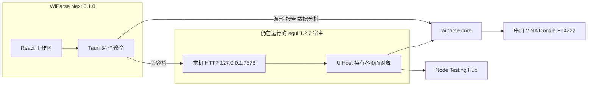

# WiParse GUI 框架重构进展评估

评估日期：2026-11-07。对象是当前工作区里 Codex 正在做的 Tauri 2 + React 迁移，不是已发布的 egui 1.2.2 安装包。

结论：**方向合理，当前实现是“新界面 + 旧宿主”的过渡预览，不能替换现有 WiParse。** 界面层和部分真实命令已经接上；设备会话、作业队列和测试编排仍在 egui 页面对象里。近期瓶颈不是再加页面，而是权威设备所有者、接口契约，以及已经重新聚合成超长文件的入口。

同日已有一份架构评审：`gui-framework-architecture-review-2026-11-07.md`。本报告按当前源码重新核对。`App.tsx` 和 `MIGRATION-STATUS.md` 的哈希已不同于那份评审记录的验证快照，因此那次前端 15 项测试不能直接算作当前界面的通过证据。

## 1. 评估范围与证据

基线提交是 `fa62efe`（egui 1.2.2）。当前分支 `cursor/four-job-shell-and-marketplace` 相对该提交有大量未提交改动。`apps/wiparse-next` 仍是未跟踪目录，不在根 Cargo workspace 的成员里。

本轮阅读了计划、迁移状态、验收计划和关键源码，并统计了文件规模。没有改业务代码，没有实机操作，没有重新跑前端或 Tauri 测试，没有打包部署。

| 证据 | 当前事实 |
|---|---|
| 旧宿主 | 根 `Cargo.toml` 仍是 egui/eframe/egui_plot 0.31，版本 1.2.2。`UiHost` 直接持有串口、仪器、波形、报告、测试、AI 等页面对象（`backend/ui.rs`） |
| 新工程 | `apps/wiparse-next`：React 18.3.1、TypeScript 5.8、Vite 5.4、Tauri 2，应用版本 0.1.0。`src-tauri` 是独立 workspace，只复用 `wiparse-core` |
| 命令桥 | `src-tauri/src/main.rs` 固定访问 `http://127.0.0.1:7878/v1/invoke`。`generate_handler!` 注册 **84** 个 Tauri 命令。读取走白名单；写操作是单独命令 |
| 鉴权 | `backend/mod.rs` 只对方法名以 `ui.ai.` 开头的请求检查 Bearer。仪器、串口、测试等旧控制路径没有同一层凭据 |
| 设备所有权 | `device_session.rs` 写明所有权、并发和生命周期仍属于宿主进程。`resource_lock.rs` 自己声明还不能称为完整设备独占 |
| 打包 | `tauri.conf.json` 中 `bundle.active` 为 false。最小窗口 1100×720。CSP 已配置 |
| 文档漂移 | 计划文件状态仍是“规划，尚未实施”。README 仍写“不能运行测试或控制设备”。源码和 `MIGRATION-STATUS.md` 已经包含运行、停止和仪器控制入口 |

关键文件规模（当前工作区）：

| 文件 | 行数 | 体积 | 说明 |
|---|---:|---:|---|
| `apps/wiparse-next/src/App.tsx` | 710 | 153 KB | 最长一行 4760 字符。页面、轮询和表单堆在一个文件里 |
| `apps/wiparse-next/src-tauri/src/main.rs` | 854 | 72 KB | 最长一行 1992 字符，即 84 个命令的注册行 |
| `src/bridge.ts` + `src/style.css` | 270 + 344 | 18 + 31 KB | 桥和样式已分开，但业务组件多数仍在 `App.tsx` |
| `instrument_control.rs` | 5399 | 232 KB | 相对基线已删掉大量死代码，文件仍然是仪器页面主体 |
| `test_tool.rs` / `waveform_analysis.rs` / `serial_tool.rs` | 5308 / 5828 / 3526 | 246 / 247 / 165 KB | 旧页面没有因新界面出现而缩小到可独立维护的程度 |
| `device_session.rs` / `resource_lock.rs` | 270 / 138 | 11 / 9 KB | 会话打开和文件锁已抽出，队列与生命周期还没走 |

`apps/wiparse-next/src` 下目前约 18 个 ts/tsx/css 文件，合计约 297 KB。前端测试文件只有 `device-interlock.test.mjs`、`model.test.mjs`、`serial-search.test.mjs`。

`docs/verification/gui-framework-review-2026-11-07/verification.json` 记录：前端 15 项通过、生产构建通过、Tauri Rust 31 项通过。核对哈希后，`main.rs`、`bridge.ts`、`package.json`、`tauri.conf.json`、`deviceInterlock.ts`、`backend/mod.rs`、`resource_lock.rs` 仍与该记录一致。`App.tsx` 和 `MIGRATION-STATUS.md` 已变化。那次记录也明确没有做桌面点击、实机、性能对照和部署。

## 2. 现在实际是三套东西

必须分开看，否则会把“新页面能点”理解成“框架已经换完”。

**旧版基线。** egui 进程既是界面，也是设备宿主。CLI、MCP 和本机 HTTP API 都回到这些页面对象，再进入 `wiparse-core` 和 Node Testing Hub。调用链短，现场功能完整。代价是页面状态和设备状态绑在一起，单文件已经到 3500–5800 行。

**当前兼容宿主。** 仍是上面这个 egui 进程，但为 Next 增加了一批 `*_safe` 方法和 AI 令牌。它的版本号还是 1.2.2。只拿一份旧的 1.2.2 便携包，接不上这批新命令。

**当前 Next。** React 在 WebView 里画界面。Tauri 命令做参数校验、文件对话框和少量离线解析，然后多数设备与测试操作通过 HTTP 交给仍在运行的 egui。波形、报告预览和数据分析有一部分直接调用 `wiparse-core`，不经过旧界面。

这不是计划里写的目标。目标是只有一个权威应用服务拥有设备会话、作业、恢复和测试编排；React 只负责显示和输入，Tauri 只负责窗口和受控桥。服务可以放在 Tauri 进程内，也可以独立进程。进程个数不是当前要先拍板的事，唯一所有者才是。

`wiparse-service` 已有本机令牌、租约和作业账本，但还没有接管旧界面的仪器会话。不能把它的名字当成全部 GUI 能力已经服务化。

## 3. 进展

不给总完成百分比。页面数、命令数和截图数都会把进度说大。84 个命令里，有的是读取，有的是保存，有的是设备操作，完成度不一样。

| 领域 | 已经落地的事实 | 还不能当成完成 |
|---|---|---|
| 外壳 | Tauri 窗口、CSP、最小尺寸、工具区和若干工作区组件 | 深浅主题、中英文、DPI 和真实桌面视觉验收。样式目前以浅色中文为主 |
| 工程与 Hub | 读取、切换、新建；运行中或旧界面有未保存更改时禁止切换。矩阵虚拟列表、快照和哈希校验。预检、单次运行、停止已有入口 | 完整工程树、配置导入导出、暂停恢复，以及桌面端到端 |
| FPGA | 测试项新建、复制、启停、部分规则和波形任务、固件文件哈希、工程仪器绑定的一部分 | 固件下载仍是预留。其余规则类型和完整表单往返未迁移 |
| 普通插件与示波器监控 | 按插件参数描述生成基础表单；监控规则可做文本条件、顺序、导入导出 JSON | 专用控件和复杂规则不完整。真实抓取未做端到端和实机验收 |
| 串口 | 状态、分页、筛选、分批查找、打开关闭日志、受限启停和发送 | 附加口、原始字节一致性、断线恢复、大日志性能。发送只表示入队 |
| 仪器 | 扫描、连接、断开、单次测量、示波器运行/停止/单次/截图/源波形，电源和负载的一部分设置 | 其他设备类型、完整控制项、跨入口所有权、实际读回 |
| 波形 | 核心解析、视口分桶、双游标、最多 3 路同单位叠加、原始点 CSV | 上限 64 MiB、32 通道、400 万点。协议分析、完整测量和其他导出还在旧界面 |
| 报告与数据 | 只读预览、工程结果索引、离线提取和范围统计 | 报告生成、实时串口分析、原版全部交互 |
| 计算器与 AI | 计算走旧核心。AI 配置、DPAPI 保护密钥、固定短句连接测试、单次确认提问 | 原串口 AI 的多轮会话、自动分析和工具链没有等价迁过来 |
| 资源锁 | 核心文件锁覆盖同名资源、COM 与 ASRL 别名的一部分，以及进程退出释放 | WinUSB、按索引打开的 FT4222、USB/VISA 物理别名未全部接入。前端 localStorage 恢复标记不是跨进程锁 |

`MIGRATION-STATUS.md` 对这些边界写得比较诚实，比 README 和计划文件更接近源码。发布条件也写明了：功能迁完、兼容接口的启动退出和数据一致性确认、新旧性能对照、实机与异常恢复之后，才进入五轮验收。五轮目前是“待执行”。迁移期间的单测和一次空数据桌面预览不能计入那五轮。

## 4. 框架是否合理

合理的是分层目标，不是当前的双宿主形态。

**值得继续的部分**

- 用 React 和 CSS 做表格、表单、Markdown 和虚拟列表，比在 egui 里手写这些布局更容易对齐和改密度。旧界面里 5000 行级的页面已经说明这一点。
- 离线解析留在 Rust。波形、报告和数据分析没有把解析器重写成 TypeScript，这是对的。
- 新入口对 AI 密钥做了 DPAPI，对读取方法做了白名单，对单次响应做了 16 MiB 上限。这些比“前端直接打未认证的本机 API”前进了一步。
- 设备打开、描述、测量、截图、源波形和负载设值开始进入 `device_session.rs`，旧界面和新命令可以共用。文件锁也开始覆盖别名。这是服务化的正确起点。
- 过渡期保留 egui 可回退，适合这个已经在现场使用的工具。

**当前形态的结构性代价**

- 设备操作多了一跳：React → Tauri → HTTP JSON → egui UI 线程 → 设备线程。多一个进程、一套窗口、一份轮询状态。`App.tsx` 里仪器和测试状态按 1 秒、2 秒、5 秒轮询。断线、超时和“结果未知”要在三层分别解释。
- 权威状态仍在页面对象上。Next 的 localStorage 互锁、进程内编辑缓存、宿主任务状态各记各的。清掉 WebView 数据、崩溃或两个界面同时开着时，恢复语义会分叉。
- 接口主要是 `serde_json::Value` 和字符串错误。编译期看不出拒绝、排队、失败和状态未知。命令没有统一的 `command_id`、`job_id`、`session_epoch`。
- 根 workspace 不包含 Next。`cargo test -p wiparse-gui` 不会编译 Tauri 工程。两套 Rust 依赖图要分别进 CI，否则 Next 会在根工程变绿时悄悄坏掉。
- 计划写“尚未实施”，README 写“只读”，源码已有仪器启停、电源负载和测试运行。按错的文档估进度，会低估危险操作的范围。

所以：**继续投资 Tauri/React 是合理的。把当前 Next 当成已完成的新框架，不合理。** 性能、安全和可靠性现在都还没有对照数据，不能从“换了 WebView”推出更快或更安全。

## 5. 问题与瓶颈

### P0，替换旧版之前必须关掉

**设备所有者仍是旧 GUI。** `UiHost` 拿着全部页面。`device_session.rs` 只是可复用的打开和分发，队列、状态和生命周期还在 egui。Next 的恢复标记写在当前 WebView 的 localStorage，约束不了旧界面、CLI、MCP、插件，也约束不了同一设备的地址别名。两个程序同时连一台电源或示波器时，谁的输出命令生效，现在没有一份可执行的所有权证明。

**控制面鉴权没有收口。** 新壳的白名单只保护“从前端发起的读取”。真正执行设备命令的仍是 7878 上的旧 API。除 `ui.ai.*` 外，本机调用者不需要 Bearer。只要旧进程开着，绕过 Tauri 就能发控制命令。CSP 和 `bundle` 配置改变不了这一点。

**核心场景还不等价。** 用户已经在用的串口 AI 多轮会话、完整波形协议分析、工程配置往返和报告生成，Next 都是子集。现在把现场包换成 Next，会丢掉这些工作路径。旧 egui 必须继续作为主版本。

### P1，继续加页面之前会卡住

**固定端口，没有能力握手。** 桥写死 `127.0.0.1:7878`。宿主仍标 1.2.2，但命令面已经不是该提交里的 1.2.2。同名旧包会缺命令；端口被占用或绑到别处时，错误容易说成“操作结果未知”。需要协议版本、能力列表和实例标识，不能靠主版本号判断兼容。

**双份大文件。** 重构的理由之一是旧页面太大。现在 `App.tsx` 153 KB、单行最长 4760 字符，`main.rs` 把 84 个命令注册挤在一行里。旧的 `instrument_control.rs`、`test_tool.rs`、`waveform_analysis.rs` 仍在 5000 行以上。新功能若继续加进这两个入口，几个月后会同时维护两套上帝文件。

**轮询和 JSON 拷贝没有预算。** 串口高负载、大日志、波形缩放和 500 项矩阵还没有与旧版在同一台机器、同一份数据上比过。64 MiB / 400 万点是新预览的保护上限，不是旧版的性能目标。在测出 UI 可见延迟之前，不值得再加一层缓存或声称新架构更流畅。

**恢复状态分散。** 服务侧没有一份权威的“这个输出命令是否已经作用到设备”。前端标记、宿主任务和独立服务租约各管一段。状态未知时，界面要求用户核对设备，这个方向对；但它还不是跨进程恢复协议。

**工程和文档没有冻结。** Next 未纳入 git。宿主、核心、插件和 `dist` 里还有大量与这次 GUI 重构混在一起的未提交改动。只报提交号 `fa62efe` 不能复现今天这套组合。`App.tsx` 在已有验证记录之后又改过，当前界面缺少一次新的构建和测试记录。

**验收还没开始。** `ACCEPTANCE-PLAN.md` 要求五轮都覆盖原版功能、数据和全部页面，再叠加专项。现在连第一轮的对照清单都还没有按可执行用例列出来。

### 瓶颈判断

当前最窄的一段不是 React 组件不够多，而是这条链：

1. 页面对象仍拥有设备。
2. 新界面只能通过无版本的 HTTP 兼容桥使用它。
3. 除 AI 外，这条桥没有统一身份。
4. 新旧入口的恢复状态不在同一个地方。

不先把串口、示波器、电源和负载的会话从 `UiHost` 里抽成一个所有者，后面每迁一个按钮，都会在两个界面里各写一次状态，并再增加一个未鉴权的 `*_safe` 方法。

## 6. 建议的推进顺序

1. **先冻结可比较的三套构建。** 旧 egui 包、当前兼容宿主、当前 Next，各自记录源码清单和二进制哈希。修正计划、README 和迁移状态，按命令标明只读、保存、设备操作。给桥加上协议版本和能力发现。这一步不改设备行为。
2. **抽一个权威会话服务，先覆盖串口、示波器、电源和负载。** 旧 GUI、Next、CLI、MCP 和插件都走它。保留现有租约和安全清理，不要在前端再加一把只对本 WebView 有效的锁来代替它。
3. **按用户真实工作补等价功能。** 优先串口 AI 多轮、波形协议、工程配置往返、报告证据。每迁一项，用同一输入对照旧版结果和文件哈希。
4. **然后才做性能。** 同一台机器上测启动、空闲内存、串口可见延迟、大日志查找、波形缩放和 500 项矩阵。数据规模用现场文件，不用预览上限代替。
5. **功能齐了再跑五轮验收。** 1100×720、1440×900、1920×1080，100/125/150% 缩放，中英文和明暗主题都要在真实窗口里看。最后才谈离线包、WebView2、升级和回退。

在第 2 步和第 3 步完成前，不建议用 Next 替换已经部署到其他电脑上的 egui 完整包，也不建议把已验证的解析器、限值规则和插件执行协议用 TypeScript 重写一遍。
