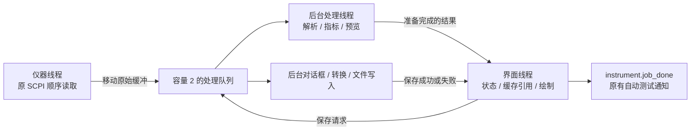

# 示波器源文件读取卡顿：原因、优化方案与影响评估

日期：2026-10-24；基于当前 1.2.2 工作区。交付为独立 EXE 预览，不覆盖此前 USB 重连、串口触发预览，不生成完整 ZIP。

## 1. 已确认的代码原因

卡顿并非简单的“USB 读取没有放到后台”。原来的仪器线程已经负责采集和解析，但数据回到主线程后仍存在以下阻塞：

1. `publish_instrument_event` 在界面线程对所有通道调用 `host_waveform_metrics`；紧接着 `handle_event` 又调用同一函数。每次都遍历完整采样数组，包含电压、频率及占空比计算。
2. `handle_event` 现场调用 `build_cached_wave_plot`，再次扫描全量 CH1 数据，生成包络和统计。
3. `run_pending_waveform_save` 在主线程调用同步 Windows 保存对话框，选择路径后继续转换格式、写文件；自动测试的 `auto_save_waveform_source` 同样在主线程创建目录、转换、保存。延迟两帧打开对话框只能改变阻塞发生的时间。
4. 仪器工作线程同时负责 I/O、合并、解析和导出准备。因此设备已完成传输后，其他仪表命令仍须等待数据处理结束。
5. API 缺少源文件读取/保存的准入约束，可能积压多个大任务；事件接收循环原先一次排空，没有帧预算。

同时发现数据完整性隐患：CH1 被从待保存的通道列表移走，而合并后的多通道数据又进入单通道转换分支。按原格式保存通常正常，但改变导出格式可能只保留部分通道。

这些结论来自代码和合成数据验证。尚未在用户报告卡顿的真实示波器、USB 驱动及具体文件上复现，不能把所有现场延迟都归因于这些环节。

## 2. 实施方案

- 仪器句柄继续由原工作线程独占，SCPI 顺序、采集停止/恢复、通道选择、屏幕时间窗口和采样密度不变。
- 捕获完毕后移动原始数据到独立后台处理线程；不再由仪器线程等待解析、指标或保存。
- 指标只计算一次，供事件发布、界面和自动测试结果共同使用。CH1 显示包络及统计也在后台准备。
- UI 仅取得已准备好的结果，不再遍历源文件采样数组，不进行源文件格式转换和写盘。
- 保留“读取后预览，再另存为”流程；保留原生文件选择器，但在后台打开，保存结果通过事件返回。
- 全通道数据由后台保存请求持有；UI 通过已有 `Arc<[f64]>` 采样轴共享 CH1，无全量数组复制。保存或取消后，其他通道的完整数据释放，保持原有长期预览内存策略。
- 单通道原始字节通过移动传递，去掉此前的一次整块原始文件复制。按原格式保存直接写原始字节。
- 处理队列容量为 2；同一宿主已有源文件读取/保存任务时，重复请求明确返回忙。GUI 同步禁用重复读取按钮，防止同时打开多个保存对话框。
- UI 接收事件按 4 ms 预算分帧处理，保留 FIFO，不丢弃排队事件；存在未完成源文件任务时独立安排重绘，防止其他命令清掉通用 busy 状态后结果无人接收。

## 3. 改动范围及兼容性

| 范围 | 本次调整 | 保持的契约 / 影响 |
|---|---|---|
| `instrument_control.rs` | 交接已准备的结果、保存完成事件、任务准入和帧预算 | 公共方法名、accepted/job_id、job_done 成功/失败流程保留 |
| `instrument_control/waveform_pipeline.rs` | 新增独立有界处理/保存线程 | 不拥有 VISA，不对仪器发命令；空闲时阻塞等待，无忙轮询 |
| `waveform_file.rs` | 抽出原 ISF 编码器为可复用字节编码函数 | 原单通道编码算法、精度和文件导出入口不变 |
| 多通道保存 | 保留 CH1 和其余所有通道，区分原样保存与格式转换 | ISF/CSV 可完整重载；多通道 WFM 保留回退 ISF 的策略；按实际文件名处理重名 |
| 自动测试 / 插件 | 继续等待保存结果后收到 job_done，包含文件路径及实测指标 | 不修改插件、任务规格、报告索引或仪器命令；失败不伪装为保存成功 |
| USB 重连 / 串口触发 | 保留当前工作区修正 | 不覆盖旧预览，不重置配置 |

刻意保留的行为：原生格式字节不变；测量和导出使用完整采样；预览抽稀仅影响绘制；自动保存不改变下一次手动保存的默认目录；取消保存仍返回取消并保留 CH1 预览。

有意新增的限制：源文件任务尚未结束时，API 重复调用会返回忙，而非无限排队。现有按 job_done 顺序执行的测试流程不受影响；并发调用者须等待前一任务完成后重试。

## 4. 风险与控制

| 风险 | 控制与验证 |
|---|---|
| 保存提前被判为完成 | 仅收到后台写盘结果后完成对应 job_id；验证成功、失败、取消三条分支 |
| UI 和后台争用可变数据 | 仅共享不可变采样轴/通道集合；无采样数据互斥锁或主线程等待 |
| 保存后长期内存增长 | 仅长期保留 CH1；弱引用测试确认其他通道在保存完成后释放 |
| 多通道转换遗漏 CH1 / 误标扩展名 | 原生文件逐字节比较；ISF/CSV 重载检查全部通道和采样值；WFM 回退检查实际路径及重名保护 |
| 断线后旧数据重新挂回新会话 | 展示前验证原 device_id 仍存在；已断开的结果完成为失败，不恢复旧预览 |
| 后台满载阻塞仪表命令 | 非阻塞交接，队列有界；阻塞处理消费端时仍验证仪表命令能完成 |
| 事件积压卡住一帧 | 分帧预算，不丢事件，队列未空则继续重绘 |
| Windows 文件对话框影响主界面 | 使用现有 rfd 后端，其 Windows 实现在调用线程初始化 COM；源文件对话框不在 egui 线程执行 |

本次不重构为“每台设备一个 VISA 线程”，也不通过强杀线程、强制断 USB 或缩减采样点数提速。原始传输阶段仍使用原串行仪器工作线程，传输中的其他仪表命令等待时间没有被本次消除；本次消除的是传输后的 CPU/保存等待和主线程重负载。进一步并行仪器 I/O 需要单独验证驱动、多会话与采集一致性。

本次也不改动其他工具的文件读取流程，或旧的“读取屏幕”事件中全量波形 JSON 的公共数据契约。

## 5. 验证记录

最终结果、构建 SHA256 和证据路径记录在 `docs/verification/scope-source-pipeline-2026-10-24/verification.json`。测试包括：

- 四通道完整指标、CH1 共享采样轴、ISF 原生字节一致、ISF/CSV 重新加载及跨格式转换。
- 单通道不重复持有原始缓冲，保存成功 / 取消 / 写盘失败、重名保护、原有手动目录保持。
- 处理队列有界、处理端忙时仪表命令仍可执行、断线结果不复活、非预览通道按时释放。
- GUI 回归、波形文件回归、插件宿主与报告测试、最终 EXE 的模拟读取/自动保存及界面切换。

本轮最终验证：GUI 182 项通过、3 项跳过、1 项已知窄栏布局用例排除；波形文件 18 项通过；插件宿主、串口触发与报告 Node 测试 21 项通过。新增管线 6 项专项测试包含在 GUI 通过数中，不重复累加。

性能对照使用合成四通道方波，在调试构建中复现原主线程的“两次全量指标 + 一次预览生成”，与新流程的事件发布及界面接收比较：

| 每通道点数 | 复现原主线程工作 | 新界面结果接收 |
|---|---:|---:|
| 100 万 | 2132.743 ms | 2.716 ms |
| 400 万 | 2777.898 ms | 1.142 ms |

这是最终代码的单次合成对照，时间受当时负载和缓存影响；不包含 USB 传输、后台解析或用户选择保存位置的时间，不代表发布版帧率或端到端提速倍数。初测与最终数字存在负载差异，不能据此计算稳定的硬件性能指标。

最终 EXE 使用模拟 RIGOL 的小记录进行 10 轮读取/自动保存，验证页面切换、另一台仪表命令、保存失败后继续读取及重名保护。38 次宿主请求的 P95 约 47 ms，最大约 110 ms；这也是小记录集成验证，不代替真实百万点记录的交互测试。此前的模拟会话重连另做 10 轮，均通过。

已知独立限制：串口可视化交付前已记录 FPGA 插件 180 像素窄栏下标题折叠；本轮不修改该布局，也不将排除该用例后的回归宣称为全部 UI 无问题。真实仪器的大记录、长时间运行、拔插及 Windows 交互式保存选择，仍需现场验收。

## 6. 现场验收建议

退出旧 WiParse，使用本次独立预览。用出现卡顿的同一台示波器，分别读取 1 通道和全部显示通道，覆盖约 100 万点和设备允许的较大记录。读取期间切换工具页、操作其他面板，观察是否能正常响应。

核对屏幕预览与源数据；依次保存原生格式、CSV，重新载入，比较通道名、点数、时间范围及幅值。验证取消、无写入权限目录、重名文件和读取中 USB 断开后的恢复。若仍慢，保留本次构建 SHA256、设备型号、每通道点数、VISA 错误及日志中的后台处理耗时，以区分传输慢、解析慢和界面停顿。
