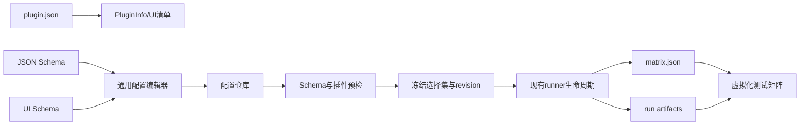

# WiParse Testing Hub 扩展规格书

**文档状态**：Draft 0.1  
**日期**：2026-10-18  
**适用宿主**：WiParse 1.1.36+  
**建议目标版本**：WiParse 1.2  
**实现记录**：[宿主实现与验收说明](./TESTING_HUB_WORKSPACE.md)；500 为最大容量，实际 0/5/N 项按实际数量呈现，不补空行。  
**关联需求**：[FPGA固件测试插件设计规范 Draft 0.6](./fpga-firmware-test-plugin-spec-2026-10-18.md)

## 1. 目的

本规格定义 Testing Hub 从“固定插件参数表单 + 单一运行状态”扩展为以下通用宿主能力：

1. 插件内可视化配置工作区；
2. 最多 500 个测试项的虚拟化测试矩阵；
3. 配置 CRUD、校验、版本冲突、归档、导入和导出；
4. 预检、运行、停止、复测与配置 revision 的一致性；
5. 分页状态 API、CLI/MCP 调用和结果导航；
6. 通用路径安全、原子保存、审计、性能和兼容机制。

该扩展必须保持宿主与具体测试业务无关。Testing Hub 不理解 FPGA、固件、复位、串口、波形或 AI 的业务含义；插件通过 JSON Schema、UI Schema、测试矩阵协议和生命周期结果描述这些内容。

## 2. 范围

### 2.1 本期范围

- 解析新的插件 UI 清单；
- schema 驱动的可视化配置编辑器；
- 配置仓库及受控文件操作；
- 最多 500 行的测试矩阵；
- 行选择、过滤、标签分组和运行选择集；
- 动态状态及运行摘要；
- 预检 revision、活动运行锁和只读状态；
- 通用配置与矩阵 API；
- 与现有 runner、overlay、项目、报告和插件生命周期兼容。

### 2.2 非目标

- 不在 Hub 中实现 FPGA 专用字段或判定规则；
- 不在 Hub 中执行固件下载、串口解析、波形分析或 AI 推理；
- 不支持多 DUT、多工位或多个测试项并发运行；
- 不提供可执行脚本、SCPI、JavaScript 或任意命令编辑器；
- 不把 JSON 源码编辑作为普通配置入口；
- 不在本期实现正式限值审批和电子签名。

## 3. 当前基线与缺口

当前 Testing Hub 已具备：

- 发现 `plugin.json`；
- 按固定 `params[]` 绘制 string、number、boolean、path、device、enum、serial_port、json、text 控件；
- `preflight/run/stop` 生命周期；
- 生成本轮 overlay；
- 读取 `status.json` 的 step、hint、cycle、elapsed_s；
- 打开项目测试结果与插件输出；
- `ui.test_tool.run`、`ui.test_tool.stop`、`ui.test_tool.browser` 后端 API。

当前缺口：

| 能力 | 当前状态 | 扩展要求 |
|---|---|---|
| 插件清单 | `PluginInfo` 不解析 `ui` 和 configure | 增加通用 UI 描述与 configure capability |
| 配置表单 | 固定 `params[]`，复杂列表只能手写 JSON | 增加 JSON Schema + UI Schema 编辑器 |
| 多配置 | 无配置仓库和 CRUD | 增加最多 500 项的配置工作区 |
| 实时状态 | 只识别单一 HUD | 增加 `wiparse.test-matrix/1` |
| 列表性能 | 普通布局 | 使用固定行高虚拟化列表/表格 |
| 文件一致性 | overlay 直接写临时文件 | 配置保存采用 revision、哈希和原子替换 |
| 活动运行 | 只限制一个 Hub job | 增加配置锁、预检 revision 和选择集快照 |
| 外部控制 | 只有 run/stop/browser | 增加 config、matrix 和 preflight 状态 API |

## 4. 设计原则

1. **宿主通用**：宿主只解释协议和 schema，不包含插件 ID 分支。
2. **插件声明**：字段、条件、帮助文本、业务校验入口和显示列由插件声明。
3. **配置与运行分离**：配置仓库保存长期测试定义，overlay 保存本轮运行参数。
4. **运行快照不可变**：run 启动后不受配置仓库后续修改影响。
5. **可视化优先**：普通用户使用类型化控件；源码仅可只读查看。
6. **冲突显式**：revision 或哈希冲突禁止静默覆盖。
7. **路径受控**：宿主校验所有配置、matrix、导入和导出路径。
8. **向后兼容**：未声明新 UI 的插件继续使用现有参数表单和 HUD。

## 5. 总体架构



宿主新增三个独立模型：

- `ConfigWorkspaceState`：配置列表、草稿、校验、归档和审计；
- `TestMatrixState`：matrix revision、分页、过滤、选择和状态摘要；
- `RunBinding`：本轮配置 manifest、preflight revision、选择集和活动锁。

现有插件目录、runner、overlay、station.json、项目和报告目录保持不变。

## 6. 插件清单扩展

### 6.1 `capabilities`

插件 schema 增加 `configure`：

```json
{
  "capabilities": ["configure", "preflight", "run", "stop"]
}
```

含义：

- `configure`：插件声明并允许宿主打开配置工作区；
- 未声明 `configure`：继续显示现有 `params[]` 表单；
- 声明 `configure` 但 UI 清单无效：插件标为清单错误，不允许进入编辑或运行。

### 6.2 `ui` 清单

```json
{
  "ui": {
    "mode": "test_matrix",
    "matrix_status_file": "{test_dir}/matrix.json",
    "max_items": 500,
    "config_editor": {
      "schema": "schemas/fpga-test-case.schema.json",
      "ui_schema": "schemas/fpga-test-case.ui.json",
      "repository": "{config_dir}",
      "archive_dir": "{config_dir}/_trash",
      "audit_file": "{config_dir}/../.editor/config-audit.jsonl",
      "max_items": 500,
      "max_item_bytes": 1048576,
      "max_total_bytes": 33554432,
      "source_view": "read_only"
    }
  }
}
```

字段规范：

| 字段 | 必须 | 说明 |
|---|---:|---|
| `ui.mode` | 是 | 本期仅新增 `test_matrix` |
| `matrix_status_file` | 是 | 模板展开后的 matrix 路径，必须位于当前 test_dir |
| `max_items` | 是 | 1–500，宿主硬上限仍为 500 |
| `config_editor.schema` | 是 | 插件目录内的 JSON Schema |
| `config_editor.ui_schema` | 否 | 插件目录内的表现层 schema |
| `repository` | 是 | 配置仓库模板，必须解析到 data_root 或用户批准的配置根 |
| `archive_dir` | 否 | 默认 `{repository}/_trash` |
| `audit_file` | 否 | 默认仓库同级 `.editor/config-audit.jsonl` |
| `max_item_bytes` | 否 | 默认 1 MiB，不得超过宿主上限 |
| `max_total_bytes` | 否 | 默认 32 MiB |
| `source_view` | 否 | 本期只允许 `hidden` 或 `read_only` |

允许的模板变量为 `{data_root}`、`{project}`、`{plugin_id}` 以及清单中 `type=path` 的参数名，例如 `{config_dir}`。参数路径必须经过用户选择或来自受控 station 配置，并继续接受路径 jail 校验。模板不得嵌套引用另一个解析结果。

### 6.3 Schema 修改

`test-tools/schemas/plugin.schema.json` 必须：

- 把 `configure` 加入 capabilities 枚举；
- 增加顶层 `ui` 定义；
- 限制 `mode`、上限、相对路径格式和 source_view；
- 保持 `additionalProperties: true`，供未来兼容扩展；
- 对不认识的未来 UI mode 给出可读错误，不影响其他插件扫描。

## 7. JSON Schema 与 UI Schema

### 7.1 JSON Schema

宿主采用 JSON Schema Draft 2020-12 的受控子集：

- `type`、`properties`、`required`、`default`；
- `enum`、`const`、`oneOf`、`anyOf`；
- `if/then/else`、`dependentRequired`；
- string 的 minLength、maxLength、pattern、format；
- number/integer 的 minimum、maximum、exclusiveMinimum、exclusiveMaximum、multipleOf；
- array 的 items、minItems、maxItems、uniqueItems；
- 本地 `$ref`，只允许解析到同一插件 schema 根目录；
- `additionalProperties: false` 用于阻止未知字段。

本期不支持远程 `$ref`、动态执行表达式、自定义 JavaScript validator 或从网络加载 schema。

### 7.2 UI Schema

UI Schema 只控制表现，不改变数据语义。建议格式：

```json
{
  "schema_version": "wiparse.ui-schema/1",
  "layout": {
    "groups": [
      { "id": "basic", "label_zh": "基本信息", "fields": ["name", "id", "enabled", "tags"] },
      { "id": "reset", "label_zh": "复位与计时", "fields": ["reset", "timing"] }
    ]
  },
  "widgets": {
    "tags": { "type": "tag_input" },
    "instruments.scope.selector": { "type": "instrument_selector", "kind": "oscilloscope" },
    "waveform_captures": { "type": "repeater", "item_style": "card", "reorder": true },
    "verdict.rules": { "type": "rule_builder", "reorder": true }
  },
  "preview": ["timeline", "resource_summary", "evidence_estimate", "json_read_only"]
}
```

宿主支持的 widget：

- text、number、switch、select；
- path_picker、file_picker；
- serial_port_selector、instrument_selector；
- tag_input、duration、unit_number；
- repeater、rule_builder；
- read_only_summary、timeline；
- json_read_only。

未知 widget 回退为 JSON Schema 的基础控件；不得回退为可编辑 JSON 文本框。

### 7.3 校验层级

| 层级 | 执行方 | 时机 | 结果 |
|---|---|---|---|
| 字段校验 | Hub | 输入时 | 控件附近显示错误 |
| 结构校验 | Hub JSON Schema | 输入后/保存前 | 阻止保存 |
| 跨字段校验 | 插件 configure lifecycle | 保存前 | error 或 warning |
| 资源校验 | 插件 preflight | 预检 | 仪器、端口、路径等实际检查 |

跨字段校验不得把插件代码嵌入 GUI 进程。宿主把候选配置写入临时 overlay，并调用 runner 新生命周期 `--lifecycle configure`；runner 调用插件导出的 `configure(ctx)`。该生命周期只做候选配置校验与规范化建议，不连接仪器、不创建 run、不修改配置仓库。超时、崩溃和非法输出作为校验错误隔离。

## 8. 配置工作区 UI

### 8.1 页面结构

宽窗口使用三栏：

1. 左栏：配置列表；
2. 中栏：类型化表单；
3. 右栏：错误、警告、时间轴、资源摘要和只读源码。

窄窗口切换为两级导航：配置列表页 → 配置编辑页；检查面板通过页签或抽屉打开。

### 8.2 配置列表

每行至少显示：

- 名称、ID；
- enabled；
- 标签；
- valid/warning/invalid；
- editor revision；
- 修改时间；
- 未保存、外部冲突、运行锁图标。

列表支持：

- 名称/ID/标签搜索；
- 状态筛选；
- order/name/updated_at 排序；
- 新建、复制、重命名、启用/禁用；
- 批量标签和批量启用/禁用；
- 可恢复归档与恢复；
- 导入、导出；
- 虚拟化滚动。

### 8.3 表单状态

配置编辑状态机：

```text
clean → dirty → validating → valid → saving → clean
                    └──────→ invalid
clean|dirty → conflict
clean|dirty → locked_read_only
```

- `dirty`：存在未保存修改；
- `invalid`：有阻断错误，保存按钮不可用；
- `conflict`：磁盘 revision/hash 与打开时不同；
- `locked_read_only`：活动 run 冻结了该配置；
- 关闭 dirty 编辑器时提供保存、放弃、取消，不静默丢失。

### 8.4 可用性规则

- 错误显示在字段附近，同时汇总到右栏；
- 点击错误定位并展开对应分组；
- 条件字段隐藏时不保留无效旧值，是否清除由 schema 明确指定；
- 数值始终显示单位；
- array 项提供稳定 item ID，拖动排序不破坏引用；
- 删除被其他字段引用的 capture/rule 时阻止或要求先解除引用；
- JSON 只读预览对密钥字段脱敏；
- 当前焦点、展开状态和列表选择在普通刷新后保留。

## 9. 配置仓库与持久化

### 9.1 目录

```text
{repository}/
  <config-id>.json
  _trash/<config-id>.<archived-at>.json
{repository}/../.editor/
  config-audit.jsonl
  import-staging/
  transactions/
```

配置文件不放在插件安装目录，避免插件升级覆盖用户数据。

### 9.2 配置元数据

每个配置必须包含：

```json
{
  "schema_version": "plugin-defined/1",
  "editor_revision": 12,
  "updated_at": "2026-10-18T10:00:00Z",
  "id": "case_001",
  "name": "Example"
}
```

宿主在返回列表时另外计算 `content_sha256`，无需把哈希写回文件本体。

### 9.3 保存算法

1. 校验 ID、schema、大小和仓库上限；
2. 比较 `expected_revision` 与 `expected_sha256`；
3. 在 `.editor/transactions` 写入包含旧状态、候选哈希和审计事件的事务意图并 flush；
4. 写入配置同目录临时文件并 flush；
5. 原子替换目标文件，必要时 flush 父目录；
6. 追加并 flush 审计事件；
7. 标记事务完成并删除事务意图；
8. 使对应 preflight revision 失效；
9. 通知配置列表和测试矩阵刷新。

Windows 上必须使用不会先删除目标文件的安全替换策略。步骤 5 后若审计写入失败，立即从事务意图恢复旧文件；恢复也失败时配置仓库进入只读恢复模式，下次启动完成事务恢复后才能继续编辑。崩溃遗留的临时文件和事务意图由启动恢复器处理，不能凭文件时间猜测提交是否完成。

### 9.4 冲突

保存请求必须携带打开时的 revision 和 SHA-256。不一致时返回 `CONFIG.REVISION_CONFLICT`，并携带当前 revision/hash；UI 提供：

- 重新加载；
- 另存为新配置；
- 查看只读差异摘要。

本期不提供自动三方合并和强制覆盖按钮。

### 9.5 归档与删除

- 普通“删除”执行归档；
- 归档移动到 `_trash`，保留原 ID、哈希、归档时间和操作者；
- 恢复时如 ID 冲突，要求重命名；
- 永久删除不在普通编辑器提供；由项目维护功能管理并写审计日志。

### 9.6 导入与导出

导出采用通用 bundle：

```json
{
  "schema_version": "wiparse.config-bundle/1",
  "plugin_id": "fpga-firmware-test",
  "plugin_version": "0.3.0",
  "exported_at": "2026-10-18T10:30:00Z",
  "items": []
}
```

导入流程先写 staging，完成以下检查后一次提交：

- bundle schema 和 plugin_id；
- 每项 JSON Schema；
- ID 冲突策略：跳过、重命名、替换；
- 数量、单文件和总容量上限；
- 路径字段不能越过批准根目录；
- 不允许导入脚本、绝对执行命令或远程 schema。

任何阻断错误都使整批导入不落盘，避免半成功状态。

## 10. 配置审计

`config-audit.jsonl` 每行一个事件：

```json
{
  "at": "2026-10-18T10:31:00Z",
  "actor": "local-user",
  "plugin_id": "fpga-firmware-test",
  "config_id": "case_001",
  "operation": "save",
  "old_revision": 11,
  "new_revision": 12,
  "old_sha256": "...",
  "new_sha256": "..."
}
```

操作类型：create、save、duplicate、rename、enable、disable、archive、restore、import、export。

审计写入失败时保存操作失败并按保存事务回滚，不允许把“配置已改变但没有审计记录”视为成功。

## 11. 测试矩阵协议

### 11.1 文件位置与写入方

- 文件：展开后的 `ui.matrix_status_file`；
- 写入方：插件运行器；
- 读取方：Testing Hub；
- 写入方法：同目录临时文件 + 原子替换；
- Hub 只读协议字段，不修改 matrix 文件。

### 11.2 Schema

```json
{
  "schema_version": "wiparse.test-matrix/1",
  "revision": 27,
  "plugin_id": "fpga-firmware-test",
  "run_id": "run-uuid",
  "preflight_revision": "manifest-sha256",
  "updated_at": "2026-10-18T10:35:00Z",
  "active_item_id": "case_001",
  "summary": {
    "total": 120,
    "selected": 20,
    "pending": 18,
    "running": 1,
    "pass": 1,
    "fail": 0,
    "error": 0,
    "skipped": 100,
    "aborted": 0,
    "inconclusive": 0
  },
  "items": [
    {
      "id": "case_001",
      "name": "基础启动验证",
      "order": 10,
      "tags": ["smoke"],
      "selected": true,
      "status": "running",
      "phase": "capturing_waveform",
      "progress": 0.4,
      "elapsed_s": 5.4,
      "message": "正在截取CH1",
      "config_revision": 12,
      "config_sha256": "...",
      "attempt": 1,
      "loop_index": 1,
      "result_ref": null,
      "error_code": null
    }
  ]
}
```

### 11.3 状态

协议状态：

- `pending` → UI `TBT`；
- `running` → UI `TESTING`；
- `pass` → UI `PASS`；
- `fail` → UI `FAIL`；
- `error` → UI `ERROR`；
- `skipped` → UI `SKIPPED`；
- `aborted` → UI `ABORTED`；
- `inconclusive` → UI `INCONCLUSIVE`。

终态不得原地回到 running。复测通过新的 attempt 表达。

### 11.4 限制

- items 最多 500；
- matrix 文件最大 4 MiB；
- name 最多 128 字符；
- message 最多 256 字符；
- tags 最多 32 个，每个最多 64 字符；
- progress 为 0–1 或 null；
- result_ref 必须是当前项目内的相对引用；
- 不允许嵌入完整日志、波形点列、AI长文本或任意 HTML。

### 11.5 轮询

- 活动运行期间每 400 ms 检查文件 mtime/size；
- 仅在 mtime 或 size 变化时解析；
- revision 必须单调递增；
- 解析失败保留上一份有效快照，并显示 `MATRIX.INVALID_SNAPSHOT`；
- 连续失败不清空已有行；
- 非活动状态仅在 preflight 完成、配置变化或用户刷新时读取。

## 12. 测试矩阵 UI

### 12.1 列

标准列：选择、序号、名称、ID、标签、状态、阶段、进度、耗时、attempt、说明和结果入口。插件可通过 UI schema 请求显示通用扩展列，但列值必须来自 matrix 的标量字段白名单。

### 12.2 交互

- 名称/ID/标签/状态过滤；
- 全选、反选、仅选当前过滤结果；
- 选择集计数和预计耗时；
- 点击配置名称进入可视化编辑；
- 点击结果打开当前 attempt 证据；
- 活动行自动保持可见，但用户手动滚动后暂停跟随；
- 运行中禁止改变当前 run 的选择集；
- 复测创建新 attempt，不覆盖原终态。

### 12.3 虚拟化

- 只绘制可见行及少量 overscan；
- 行高固定或按两档固定高度，禁止每帧测量全部行；
- 过滤和排序在快照变化时计算，不在每帧重新计算；
- 状态颜色、图标和文字必须同时表达，不能只依赖颜色；
- 500 行状态刷新不得阻塞 runner 输出和 Stop 操作。

## 13. 选择集与运行绑定

Hub 在预检/运行 overlay 中新增：

```json
{
  "test_matrix": {
    "config_manifest_sha256": "...",
    "preflight_revision": "...",
    "selected_item_ids": ["case_001", "case_002"],
    "filters": {
      "name": "boot",
      "tags": ["smoke"],
      "tag_mode": "any"
    }
  }
}
```

规则：

- 运行只接受最近一次成功预检产生的 manifest；
- 配置保存、归档、恢复或导入后使 preflight revision 失效；
- run 启动时冻结 manifest 和 selected_item_ids；
- 运行中 UI 选择变化不影响当前 run；
- 未选项由插件写 `skipped/not_selected`；
- 同一 station 已有活动 run 时返回 `RUN.STATION_BUSY`。

## 14. 配置锁与运行锁

锁分两层：

| 锁 | 范围 | 作用 |
|---|---|---|
| Hub job lock | 当前 Testing Hub | 保持现有一次只运行一个 job |
| config read lock | 本轮 manifest 中的配置 | 阻止运行中修改本轮配置 |

锁不是永久文件权限。异常退出后，Hub 根据 job/process/run.lock 状态清理陈旧锁；清理必须记录原因。

运行中：

- 本轮配置只读；
- 非本轮配置允许编辑，但保存后只影响下一次预检；
- schema/UI schema/插件版本变化时整个工作区进入只读，直到当前 run 结束；
- Stop 按钮始终优先可用。

## 15. 后端 API

现有 API 保持不变：

- `ui.test_tool.browser`；
- `ui.test_tool.run`；
- `ui.test_tool.stop`。

新增 API：

| 方法 | 作用 |
|---|---|
| `ui.test_tool.config.list` | 分页列出配置及摘要 |
| `ui.test_tool.config.get` | 读取单项及 schema/UI schema 元数据 |
| `ui.test_tool.config.create` | 创建草稿配置 |
| `ui.test_tool.config.save` | revision/hash 条件保存 |
| `ui.test_tool.config.duplicate` | 复制为新 ID |
| `ui.test_tool.config.archive` | 可恢复归档 |
| `ui.test_tool.config.restore` | 恢复归档配置 |
| `ui.test_tool.config.import` | 导入 bundle |
| `ui.test_tool.config.export` | 导出 bundle |
| `ui.test_tool.matrix.get` | 获取摘要或分页 items |
| `ui.test_tool.preflight.state` | 获取最近预检 revision 与有效性 |

### 15.1 保存请求

```json
{
  "plugin_id": "fpga-firmware-test",
  "config_id": "case_001",
  "expected_revision": 11,
  "expected_sha256": "...",
  "value": {},
  "validate_only": false
}
```

成功结果：

```json
{
  "config_id": "case_001",
  "revision": 12,
  "sha256": "...",
  "valid": true,
  "warnings": [],
  "preflight_invalidated": true
}
```

### 15.2 分页

list 和 matrix.get 使用：

- `offset`，默认 0；
- `limit`，默认 100，最大 500；
- `query`；
- `statuses[]`；
- `tags[]`；
- `sort` 与 `direction`。

API 不返回文件系统绝对路径、完整日志或波形内容。

## 16. CLI 与 MCP 映射

CLI 建议新增：

```text
wiparse ui test-tool config list --plugin <id>
wiparse ui test-tool config get --plugin <id> --config <id>
wiparse ui test-tool config save --plugin <id> --config <id> --file <json>
wiparse ui test-tool config archive --plugin <id> --config <id>
wiparse ui test-tool matrix --plugin <id> --offset 0 --limit 100
```

MCP `wiparse_ui` 扩展相同操作，但保持结果有界；不得通过 MCP 返回大型配置 bundle、日志或波形正文。导入/导出使用受控文件路径和项目 jail。

## 17. 生命周期集成

### 17.1 Configure

`configure` 同时表示宿主 UI capability 和 runner 的轻量校验生命周期，不取代 preflight。插件可导出：

```js
export async function configure(ctx) {
  return {
    ok: true,
    lifecycle: "configure",
    errors: [],
    warnings: [],
    normalized_value: ctx.overlay?.config ?? null
  };
}
```

configure 不分配 stamp、不创建 run、不复位 DUT、不连接长时仪器会话，也不得直接保存配置。只有 Hub 在结果有效且 revision 未变化时执行 ConfigStore 原子保存。

### 17.2 Preflight

预检前 Hub 检查：

- 无未保存草稿；
- 配置仓库未超限；
- 所选配置 schema 有效；
- 没有 revision/hash 冲突；
- station 无活动 run。

插件预检成功后返回：

```json
{
  "ok": true,
  "lifecycle": "preflight",
  "test_matrix": {
    "manifest_sha256": "...",
    "revision": "...",
    "item_count": 120,
    "matrix_status_file": "..."
  }
}
```

### 17.3 Run

Hub 启动 run 前再次比较 manifest/revision。如果变化，返回 `PREFLIGHT.STALE`，不启动 runner。run.json 必须记录 plugin version、schema version、manifest hash 和 selected IDs。

### 17.4 Stop

保持现有 stop file 语义。matrix 中当前项最终进入 aborted 或 error，尚未开始项由插件根据停止原因写 pending/skipped。Stop 不等待 UI matrix 完成刷新才返回。

## 18. 错误模型

统一错误结构：

```json
{
  "code": "CONFIG.REVISION_CONFLICT",
  "message": "配置已在其他会话中修改",
  "plugin_id": "fpga-firmware-test",
  "config_id": "case_001",
  "field_path": null,
  "retryable": false,
  "details": {}
}
```

必须定义：

| 错误码 | 含义 |
|---|---|
| `PLUGIN.UI_MANIFEST_INVALID` | UI 清单无效 |
| `SCHEMA.UNSUPPORTED_KEYWORD` | 使用未支持的 schema 功能 |
| `SCHEMA.VALIDATION_FAILED` | 配置结构无效 |
| `CONFIG.NOT_FOUND` | 配置不存在 |
| `CONFIG.ID_CONFLICT` | ID 已存在 |
| `CONFIG.REVISION_CONFLICT` | revision/hash 冲突 |
| `CONFIG.LOCKED_BY_RUN` | 当前 run 锁定配置 |
| `CONFIG.REPOSITORY_LIMIT` | 数量或容量超限 |
| `CONFIG.IMPORT_REJECTED` | 导入整体失败 |
| `CONFIG.PATH_OUTSIDE_ROOT` | 路径越界 |
| `PREFLIGHT.REQUIRED` | 尚无成功预检 |
| `PREFLIGHT.STALE` | 配置变化导致预检过期 |
| `MATRIX.INVALID_SNAPSHOT` | matrix 无法解析 |
| `MATRIX.REVISION_ROLLBACK` | matrix revision 回退 |
| `MATRIX.TOO_LARGE` | matrix 超出限制 |
| `RUN.STATION_BUSY` | 工位已有活动 run |

## 19. 路径与安全

- schema 和 UI schema 必须位于插件目录内；
- 配置仓库必须位于 data_root 或用户批准的配置根；
- matrix 必须位于当前 test_dir；
- 导入/导出必须通过 canonical path 检查；
- Windows 上必须检查 reparse point/junction，不能只检查字符串前缀；
- 配置 ID 只能匹配 `^[A-Za-z0-9][A-Za-z0-9._-]{0,63}$`；
- 文件选择器返回的路径按插件 schema 限定根目录和扩展名；
- UI Schema 不允许脚本、HTML、URL 资源或表达式执行；
- 只读 JSON 预览对 secret/password/token/key 字段脱敏；
- 导入内容一律视为不可信数据，不视为指令；
- 配置保存和 matrix 解析不得阻塞主 UI 线程。

## 20. 性能要求

在 500 个配置、4 MiB matrix 上限内：

- 打开配置列表后首屏在 500 ms 内可交互；
- 搜索和状态过滤在 100 ms 内更新；
- 普通字段输入到本地校验反馈不超过 100 ms；
- matrix 文件变化到可见状态更新目标不超过 800 ms；
- 滚动只绘制可见行，交互过程中不遍历和布局全部 500 行；
- matrix 解析、schema 校验和文件 I/O 在后台任务执行；
- Stop 操作不受配置校验、导入或 matrix 解析阻塞；
- 连续无变化时不重复解析 matrix。

时间要求为本机工程目标，不作为仪器操作时延保证。

## 21. 可访问性与视觉规范

- PASS/FAIL 等状态同时使用文字、图标和颜色；
- ERROR 与 FAIL 视觉上明确区分；
- 选中、焦点、hover 和只读状态有清晰边界；
- 错误文本不只出现在 tooltip；
- 控件标签、单位、帮助和错误支持中英文；
- 重要按钮顺序固定：保存、预检、运行、停止；
- 危险操作使用“归档”措辞，永久删除不出现在普通流程；
- 窄屏不横向压缩表单字段到不可读，改用页面切换。

## 22. 向后兼容

### 22.1 旧插件

- 没有 `ui`：行为完全不变；
- 没有 configure：继续使用 params[]；
- 没有 matrix：继续使用 status.json HUD；
- 旧 runner 参数和 overlay 格式保持不变。

### 22.2 新插件在旧宿主

- plugin.schema 的 engines.wiparse 应声明最低版本；
- 旧宿主若忽略 `ui`，插件仍可通过 runner/CLI 运行，但不提供矩阵和编辑器；
- 需要配置工作区才能安全运行的插件可在 preflight 返回 `HOST.CAPABILITY_MISSING`；
- 不允许旧宿主退回到手写 JSON 文本框。

### 22.3 Marketplace

- 安装时校验 schema/UI schema 文件存在；
- 插件升级不得覆盖 data_root 配置仓库；
- schema 版本提升时，插件提供显式 migration；
- migration 先生成备份和预览，用户确认保存后才替换配置；
- migration 不在活动 run 中执行。

## 23. 建议代码结构

避免继续扩大单一 `test_tool.rs`，建议拆分：

```text
crates/wiparse-gui/src/
  test_tool.rs
  test_tool/
    manifest.rs
    config_workspace.rs
    schema_form.rs
    config_store.rs
    matrix.rs
    run_binding.rs
    api.rs
```

需要修改：

- `crates/wiparse-gui/src/test_tool.rs`：集成状态与页面入口；
- `crates/wiparse-gui/src/backend/ui.rs`：新增 API 路由；
- `crates/wiparse-gui/src/backend/capabilities.rs`：公布新方法；
- `crates/wiparse-cli/src/main.rs`：新增 CLI 子命令；
- `mcp/wiparse/src/index.ts`：新增有界 MCP 操作；
- `test-tools/schemas/plugin.schema.json`：清单扩展；
- `test-tools/lib/plugin-contract.mjs`：模板、结果信封和兼容解析；
- `test-tools/runner.mjs`：configure lifecycle 与 test_matrix 结果转发；
- `test-tools/PLUGIN_SPEC.md`：公开插件作者协议。

## 24. 测试要求

### 24.1 单元测试

- manifest/ui 清单解析；
- JSON Schema 条件、数组、引用和错误路径；
- UI widget 回退；
- revision/hash 冲突；
- 原子保存失败恢复；
- 保存事务在替换前、替换后和审计写入后崩溃的恢复；
- 路径 jail、junction/reparse point；
- 配置数量和容量上限；
- matrix 状态转换、revision 和大小限制；
- 过滤、排序、分页和选择集。

### 24.2 集成测试

- 旧插件 params/HUD 无回归；
- 新建→保存→预检→运行→结果完整闭环；
- 保存后 preflight 失效；
- run 中配置只读；
- 异常退出后锁恢复；
- 500 配置导入、显示、过滤和运行选择；
- matrix 写入半文件、坏 JSON、revision 回退；
- Marketplace 升级不覆盖仓库。

### 24.3 UI 测试

- 宽/窄布局；
- 中英文；
- 键盘焦点和错误定位；
- 500 行滚动；
- 未保存、冲突、只读、归档恢复；
- Stop 在后台校验或 matrix 刷新期间仍可点击。

## 25. 验收标准

### 25.1 配置工作区

- 普通用户无需编辑源码即可完成全部配置；
- 新建、复制、编辑、批量标签、启用/禁用、归档、恢复、导入、导出可用；
- 阻断错误不能保存，warning 可保存且持续可见；
- 条件字段、重复数组、单位和引用正确工作；
- 外部修改不会被静默覆盖；
- 活动 run 的配置只读；
- 每次修改具有 revision、哈希和审计记录。

### 25.2 测试矩阵

- 支持 1、100、500 行；501 行明确拒绝；
- 状态、过滤、选择、标签、attempt、结果入口正确；
- 坏 matrix 不清空最后有效快照；
- 行状态与最终 matrix 及报告一致；
- 500 行滚动和 400 ms 状态轮询无明显卡顿。

### 25.3 生命周期

- 无成功预检或 preflight 过期时不能运行；
- run 使用冻结 manifest 和选择集；
- 修改配置只影响下一次运行；
- Stop 始终可用且不启动下一测试项；
- 同一 station 不能启动第二个 run。

### 25.4 兼容与安全

- 现有插件界面和运行行为无回归；
- 配置、matrix 和导入路径无法越过受控根；
- 不能通过 UI schema 执行代码或加载远程资源；
- 插件升级不覆盖用户配置；
- API、CLI 和 MCP 返回数据有界且不泄露绝对路径或密钥。

## 26. 实施阶段

### 阶段 A：协议与存储

- 扩展 plugin schema 与 PluginInfo；
- 实现 ConfigStore、路径 jail、原子保存、revision/hash、审计；
- 实现 matrix schema 和解析器；
- 完成单元测试。

### 阶段 B：配置工作区

- 实现 schema 表单基础控件；
- 实现三栏布局、列表虚拟化、校验和只读预览；
- 实现 CRUD、归档、导入/导出与冲突 UI。

### 阶段 C：测试矩阵

- 实现 matrix 轮询、虚拟化表格、过滤、选择和状态摘要；
- 把选择集和 preflight revision 写入 overlay；
- 集成结果导航。

### 阶段 D：API 与生态

- 增加后端 API、CLI、MCP；
- 更新 runner、plugin-contract、PLUGIN_SPEC；
- 验证旧插件与 Marketplace 升级。

### 阶段 E：FPGA 插件验证

- 使用 FPGA固件测试插件 schema/UI schema 验证条件表单、波形 repeater 和规则构建器；
- 使用 500 项模拟配置验证性能；
- 注入坏文件、冲突、掉电、matrix 损坏和活动锁故障；
- 通过验收后再接入真实仪器。

## 27. 风险与反对意见

1. **反对在 Hub 中写 FPGA 专用控件。** 专用字段应由 schema/UI schema 声明，否则后续插件无法复用。
2. **反对把任意 JSON 文本框当作可视化编辑器。** 它不能提供条件字段、单位、引用和跨字段校验。
3. **反对运行时直接读取活动配置文件。** 必须使用冻结 manifest，否则一轮测试内可能混用两个版本。
4. **反对只靠 mtime 处理保存冲突。** 使用 revision + SHA-256，mtime 只用于快速发现变化。
5. **反对把 500 行全部常驻布局。** 必须虚拟化并缓存过滤结果。
6. **反对把完整日志或波形塞入 matrix/API。** 只返回摘要和结果引用。
7. **反对配置仓库位于插件安装目录。** Marketplace 更新可能覆盖用户数据。
8. **反对无审计的永久删除。** 普通操作只归档；永久删除属于项目维护。

## 28. 待实现时确认的工程参数

以下不影响协议方向，但编码前需在实现任务中确认：

1. Rust 侧采用的 JSON Schema validator crate 及 Draft 2020-12 覆盖范围；
2. Windows 原子替换与目录 flush 的具体封装；
3. egui 虚拟表格采用现有 ScrollArea 行裁剪还是引入表格组件；
4. 本地 actor 标识来源；
5. 导出 bundle 的文件选择与项目外路径授权交互。

