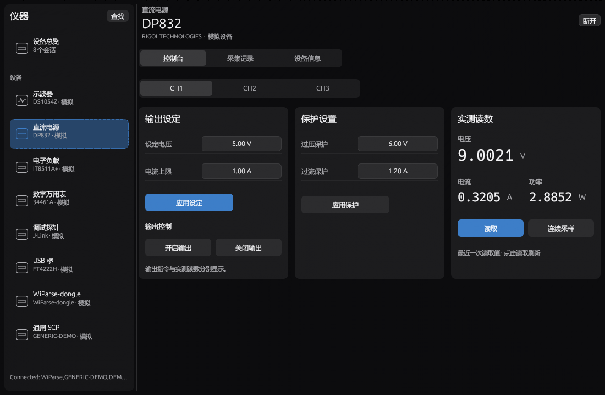
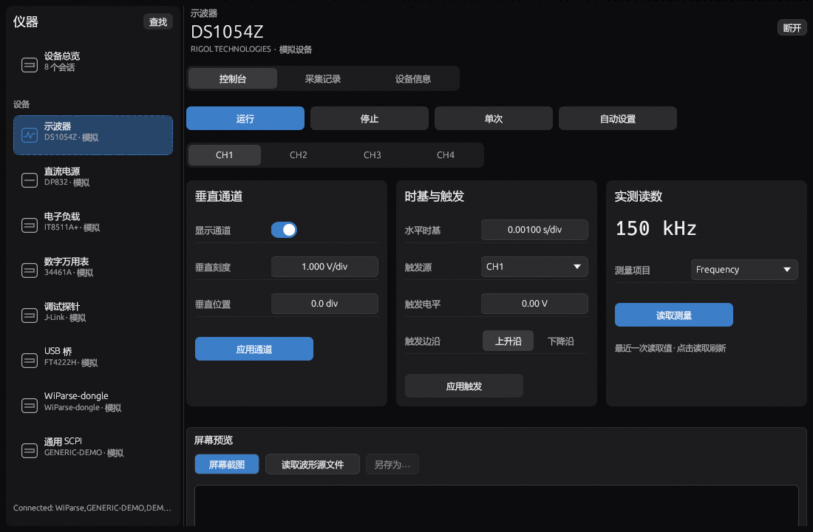

# 仪表控制平铺布局评审与修正

日期：2026-10-17；版本：1.1.33。

## 问题分析

旧页面的主要问题是信息组织，而非配色：控制台下又有接口、任务及参数页签，同一操作需要多次寻找；电源保护和 Dongle 连接参数折叠，关键上下文不可见；左右两栏使用不同宽度和高度，按钮被拉伸，读数过大，空白和信息密度不均。单独压缩边距无法解决这些问题。

## 设计与实现

保留仪器列表和控制台/采集记录/设备信息三个职责清晰的一级入口。控制台取消内部任务页签，采用从左至右、从上至下的等宽网格。保留通道选择，因为它决定命令实际作用的硬件通道。每张面板有唯一标题，参数在上、对应操作在下，接收记录使用完整行宽。

| 仪器 | 控制台直接显示 |
|---|---|
| 示波器 | 运行/停止/单次/自动设置、通道选择；垂直通道、时基与触发、实测读数并列；屏幕预览置于下方 |
| 直流电源 | 通道选择；输出设定、过压/过流保护、实测读数并列 |
| 电子负载 | 负载模式及设定、输入开关与实测读数 |
| 万用表 | 测量功能、量程、NPLC 与读数 |
| 调试探针 | 目标控制、固件烧录、内存访问、RTT 平铺 |
| USB 桥 | SPI、I2C、GPIO 平铺 |
| WiParse-Dongle | DAP 目标、UART、I2C 优先排列，随后固件、内存和 RTT；连接参数、总线工具展开 |
| 通用 SCPI | 保留直接命令输入与响应记录 |

### 尺寸与视觉规则

- 面板最小目标宽度 260 逻辑像素，间隔 12；按可用宽度自动使用 1～3 列。
- 同排等宽、顶部对齐，按本排内容高度统一背景；窗口宽度变化后重新计算。
- 面板内边距 12；参数行高 34；编辑控件高度 28；按钮高度 32，宽度上限 160，按钮组按等宽列换行。
- 标签和编辑器统一列线；读数缩小，保持主次与单位可读；使用软件既有主题、圆角和强调色。
- UART/I2C 读取、写入按钮明确标出接口，避免展开后同名操作混淆。
- 复位、擦除仍有独立的低频操作入口；普通保护、连接、总线工具不再折叠。

## 兼容性与交互约束

不改变驱动、协议、采集队列、测试契约或报告结果语义。渲染展开面板不会发送命令。每张面板的编辑 ID 包含设备、功能和通道，避免未提交数字串扰。临时接口路由在构造命令后还原；命令携带实际参数进入原有有序队列。应用电源设定不自动开启输出；实测值与输出请求分开显示。Dongle I2C 事务仍先应用当前端点，端点重复应用不得关闭 UART。

## 验证

验证记录与截图随发布包保存。工作区 Rust 回归 386 项通过、1 项外部 SCP 文件测试维持忽略；插件测试 67 项通过，MCP 6 个工具和 4 项报告分发检查通过。界面覆盖 252 组主工具、432 组已连接仪器和 32 组未连接仪器渲染，保存 18 张深浅主题预览。包含面板标题直接可见、同排对齐、等高且高度收敛、纯渲染不发命令、通道切换数字编辑隔离、电源应用不启用输出、I2C 当前端点以及既有布局回归。深浅主题、中英文、不同窗口尺寸均检查。图为模拟设备实际 egui 渲染，不代表硬件实测验收。

发布验证还修正了检查脚本在 Windows PowerShell 5 下写入配置 BOM 的问题：统一输出无 BOM UTF-8，并检查启动日志，防止误用默认配置导致模拟模式未启用。发布包启动脚本原本已使用无 BOM UTF-8。

## 页面预览

以下为模拟仪器渲染；完整深浅主题预览位于同名目录。

