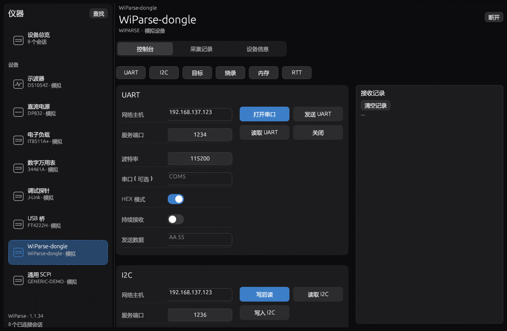
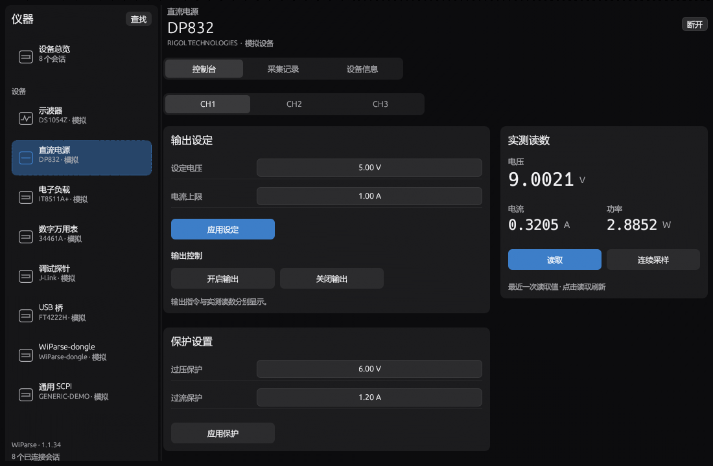
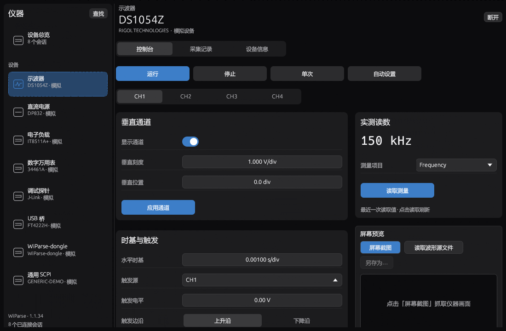
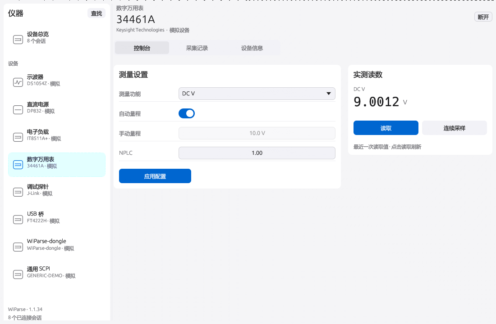

# 仪表控制界面系统性评审与修正 — 1.1.34

## 问题与原因

1. 上一版用三列等高卡片承载不同工作量的表单。DAP 目标控制与 UART/I2C 的字段数差距很大，导致空白、按钮位置不一致和过长页面。统一外框不等于统一操作逻辑。
2. 所有内容共用外层滚动区，接收记录和屏幕预览位于表单之后，查看结果需要离开操作位置。
3. `add_enabled_ui` 嵌套在横向按钮换行区中，部分禁用/启用容器不按单个按钮换行。实测调试探针内存操作行宽度为 638.4 px，而可用宽度只有 470.4 px，导致相邻区域被推走。此前的有限网格/无崩溃检查未覆盖此类几何问题。
4. 输入框、按钮与 SCPI 控制台尺寸不一致；侧栏展示原始连接日志，不便确认实际程序版本。
5. 本机检查时运行路径为 `dist/WiParse.exe`，文件版本是 1.1.32；1.1.33 位于独立版本包。交付版本与实际启动版本不一致，但这不免除 1.1.33 布局本身的问题。

## 设计与落实

- 阅读顺序固定为选择设备/通道、设置参数、明确执行、查看结果。保留应用设定与开启输出的分离，不能把排版调整变成额外硬件动作。
- 控制台可用宽度达到 720 px 时，设置区与结果区独立滚动。设置列宽按可用宽度分配并设上下限；结果区使用明确边界，不受内部表单最小宽度影响。
- 端口设备以任务为单位纵向排列。任务内有足够宽度时参数在左、操作网格在右；不足时操作移到参数下方。每项任务使用自然高度，不通过延迟测量拉伸成等高卡片。
- 探针、USB 桥、Dongle 提供页内定位按钮；点击仅滚动到任务，不切换接口、不发送命令。任务保持展开。
- 窄窗口采用单列，结果区紧跟第一项任务，避免位于所有调试表单之后。
- 按钮禁用直接作用于按钮，去掉破坏换行的中间容器。危险擦除仍保留醒目颜色和原有条件限制。
- SCPI 输入框与发送按钮统一为 32 px；参数文本与数值编辑器保持统一列宽。明暗主题沿用应用现有配色和字体。
- 仪表侧栏显示实际编译版本和连接会话数，完整连接状态保留在悬停提示中。

采集记录页同时修正了全宽开始按钮和随机、挤压的读数标签：采集工具栏使用固定尺寸，读数按通道及电压/电流/功率稳定排序并按网格排列。清空和 CSV 导出现在仅作用于当前设备，避免误清或混入其他设备的记录；缓冲区总点数上限不变。

## 各设备页面

| 设备 | 设置区 | 结果区 |
| --- | --- | --- |
| 示波器 | 通道、时基与触发；运行操作和通道选择保持在上方 | 当前通道测量、屏幕预览 |
| 直流电源 | 当前通道输出设定、独立开关、保护参数 | 电压、电流、功率和采样控制 |
| 电子负载 | 模式、目标值、独立输入开关 | 电压、电流、功率和采样控制 |
| 万用表 | 测量功能、量程、NPLC | 与测量功能匹配的读数和采样控制 |
| 调试探针 | 目标、固件、内存、RTT | 接收记录 |
| USB 桥 | SPI、I2C、GPIO | 接收记录 |
| WiParse-Dongle | UART、I2C、DAP、固件、内存、RTT | 接收记录 |
| 通用 SCPI | 等高命令输入与发送 | 命令及响应日志 |

采集记录、设备信息、连接入口和设备总览继续使用一致的主题与共享参数组件；不得删除原有采集、维护、设备信息功能。

## 验证边界

使用实际 egui 布局和字体纹理导出页面，经软件光栅化检查明暗主题；这些不是设计稿。布局回归覆盖中文、英文和多种窗口尺寸，并检查结果区位置稳定、页内定位、字段对齐、命令隔离和通道编辑隔离。最终通过数量和运行时验证见包内 `docs/verification/release-1.1.34.json`。

真实硬件验收不包含在本次 UI 验证中；自动布局通过不能代替用户对视觉效果的评价。串口资源历史数据不代表本版新测量。

短窗口验证额外覆盖 120、160、240、360 px 的工作区高度，保证控制台不超出可视边界。全部自动验证完成后，以包内验证 JSON 为最终记录。

## 实际界面

可对照 [1.1.33 的 Dongle 页面](ui-flat-instruments-1.1.33/instrument-6-tab-0-mode-0-dark.png)。

## 完整页面索引

每个设备保存控制台、采集记录、设备信息三页的明暗主题图片，共 50 张（含设备总览）。

| 设备 | 控制台 | 采集记录 | 设备信息 |
| --- | --- | --- | --- |
| 示波器 | [深色](ui-instrument-workspace-1.1.34/instrument-0-tab-0-mode-0-dark.png) / [浅色](ui-instrument-workspace-1.1.34/instrument-0-tab-0-mode-0-light.png) | [深色](ui-instrument-workspace-1.1.34/instrument-0-tab-1-mode-0-dark.png) / [浅色](ui-instrument-workspace-1.1.34/instrument-0-tab-1-mode-0-light.png) | [深色](ui-instrument-workspace-1.1.34/instrument-0-tab-2-mode-0-dark.png) / [浅色](ui-instrument-workspace-1.1.34/instrument-0-tab-2-mode-0-light.png) |
| 直流电源 | [深色](ui-instrument-workspace-1.1.34/instrument-1-tab-0-mode-0-dark.png) / [浅色](ui-instrument-workspace-1.1.34/instrument-1-tab-0-mode-0-light.png) | [深色](ui-instrument-workspace-1.1.34/instrument-1-tab-1-mode-0-dark.png) / [浅色](ui-instrument-workspace-1.1.34/instrument-1-tab-1-mode-0-light.png) | [深色](ui-instrument-workspace-1.1.34/instrument-1-tab-2-mode-0-dark.png) / [浅色](ui-instrument-workspace-1.1.34/instrument-1-tab-2-mode-0-light.png) |
| 电子负载 | [深色](ui-instrument-workspace-1.1.34/instrument-2-tab-0-mode-0-dark.png) / [浅色](ui-instrument-workspace-1.1.34/instrument-2-tab-0-mode-0-light.png) | [深色](ui-instrument-workspace-1.1.34/instrument-2-tab-1-mode-0-dark.png) / [浅色](ui-instrument-workspace-1.1.34/instrument-2-tab-1-mode-0-light.png) | [深色](ui-instrument-workspace-1.1.34/instrument-2-tab-2-mode-0-dark.png) / [浅色](ui-instrument-workspace-1.1.34/instrument-2-tab-2-mode-0-light.png) |
| 万用表 | [深色](ui-instrument-workspace-1.1.34/instrument-3-tab-0-mode-0-dark.png) / [浅色](ui-instrument-workspace-1.1.34/instrument-3-tab-0-mode-0-light.png) | [深色](ui-instrument-workspace-1.1.34/instrument-3-tab-1-mode-0-dark.png) / [浅色](ui-instrument-workspace-1.1.34/instrument-3-tab-1-mode-0-light.png) | [深色](ui-instrument-workspace-1.1.34/instrument-3-tab-2-mode-0-dark.png) / [浅色](ui-instrument-workspace-1.1.34/instrument-3-tab-2-mode-0-light.png) |
| 调试探针 | [深色](ui-instrument-workspace-1.1.34/instrument-4-tab-0-mode-0-dark.png) / [浅色](ui-instrument-workspace-1.1.34/instrument-4-tab-0-mode-0-light.png) | [深色](ui-instrument-workspace-1.1.34/instrument-4-tab-1-mode-0-dark.png) / [浅色](ui-instrument-workspace-1.1.34/instrument-4-tab-1-mode-0-light.png) | [深色](ui-instrument-workspace-1.1.34/instrument-4-tab-2-mode-0-dark.png) / [浅色](ui-instrument-workspace-1.1.34/instrument-4-tab-2-mode-0-light.png) |
| USB 桥 | [深色](ui-instrument-workspace-1.1.34/instrument-5-tab-0-mode-0-dark.png) / [浅色](ui-instrument-workspace-1.1.34/instrument-5-tab-0-mode-0-light.png) | [深色](ui-instrument-workspace-1.1.34/instrument-5-tab-1-mode-0-dark.png) / [浅色](ui-instrument-workspace-1.1.34/instrument-5-tab-1-mode-0-light.png) | [深色](ui-instrument-workspace-1.1.34/instrument-5-tab-2-mode-0-dark.png) / [浅色](ui-instrument-workspace-1.1.34/instrument-5-tab-2-mode-0-light.png) |
| WiParse-Dongle | [深色](ui-instrument-workspace-1.1.34/instrument-6-tab-0-mode-0-dark.png) / [浅色](ui-instrument-workspace-1.1.34/instrument-6-tab-0-mode-0-light.png) | [深色](ui-instrument-workspace-1.1.34/instrument-6-tab-1-mode-0-dark.png) / [浅色](ui-instrument-workspace-1.1.34/instrument-6-tab-1-mode-0-light.png) | [深色](ui-instrument-workspace-1.1.34/instrument-6-tab-2-mode-0-dark.png) / [浅色](ui-instrument-workspace-1.1.34/instrument-6-tab-2-mode-0-light.png) |
| 通用 SCPI | [深色](ui-instrument-workspace-1.1.34/instrument-7-tab-0-mode-0-dark.png) / [浅色](ui-instrument-workspace-1.1.34/instrument-7-tab-0-mode-0-light.png) | [深色](ui-instrument-workspace-1.1.34/instrument-7-tab-1-mode-0-dark.png) / [浅色](ui-instrument-workspace-1.1.34/instrument-7-tab-1-mode-0-light.png) | [深色](ui-instrument-workspace-1.1.34/instrument-7-tab-2-mode-0-dark.png) / [浅色](ui-instrument-workspace-1.1.34/instrument-7-tab-2-mode-0-light.png) |
