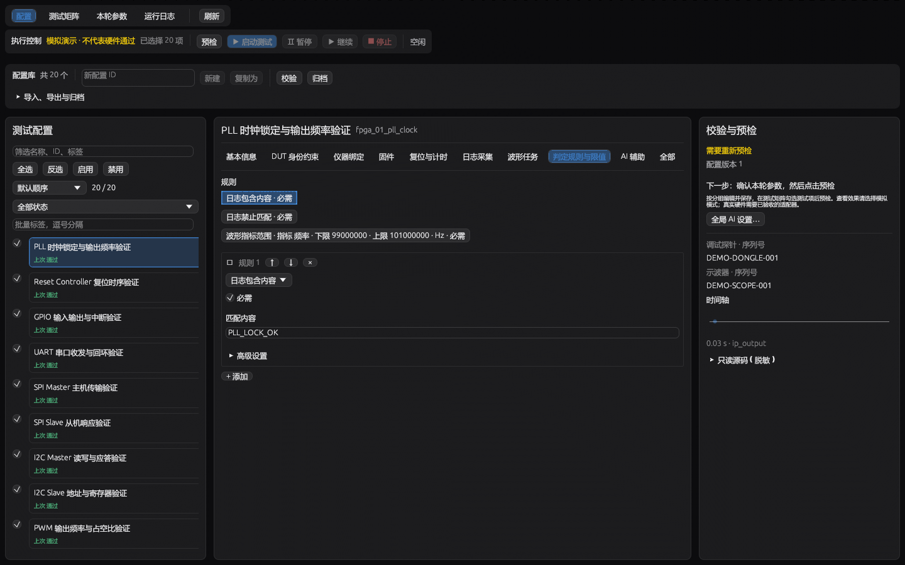
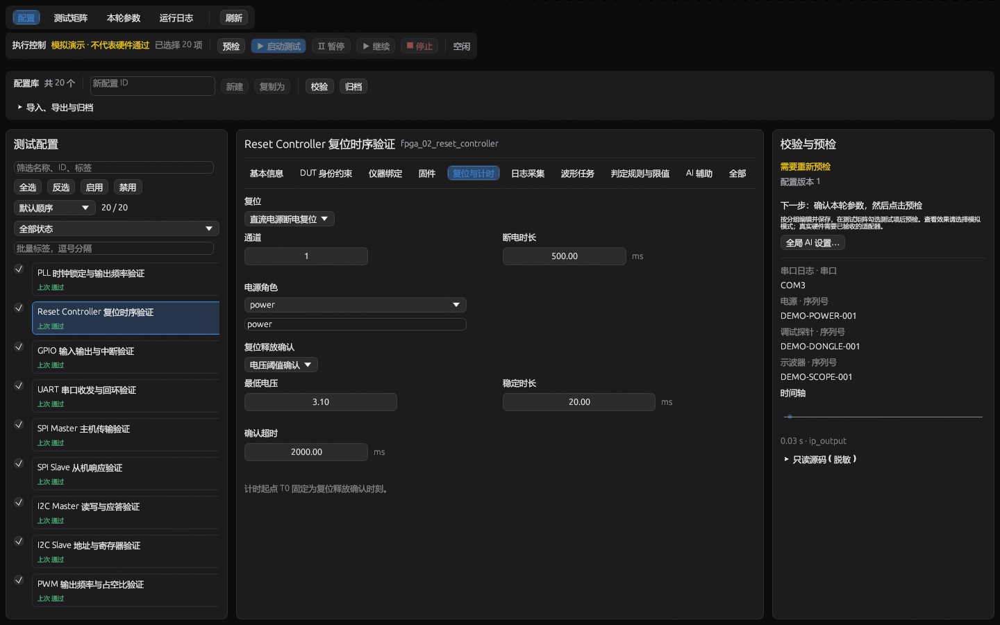
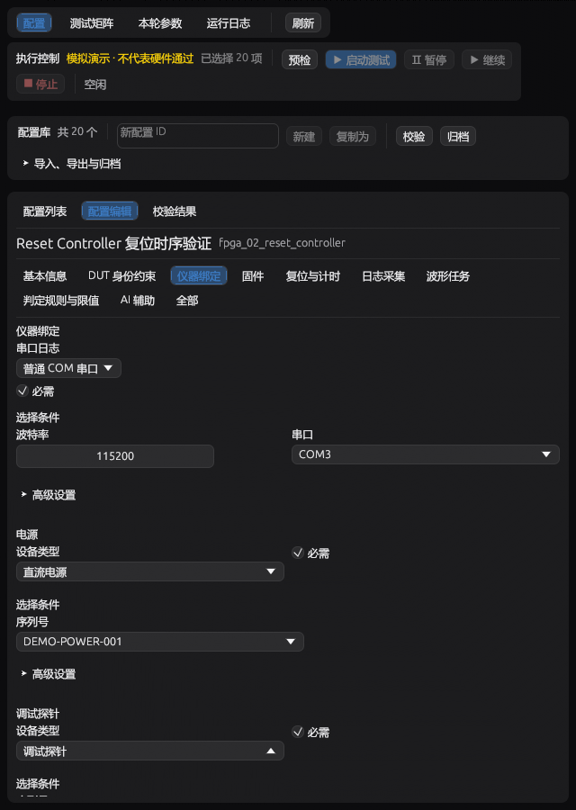
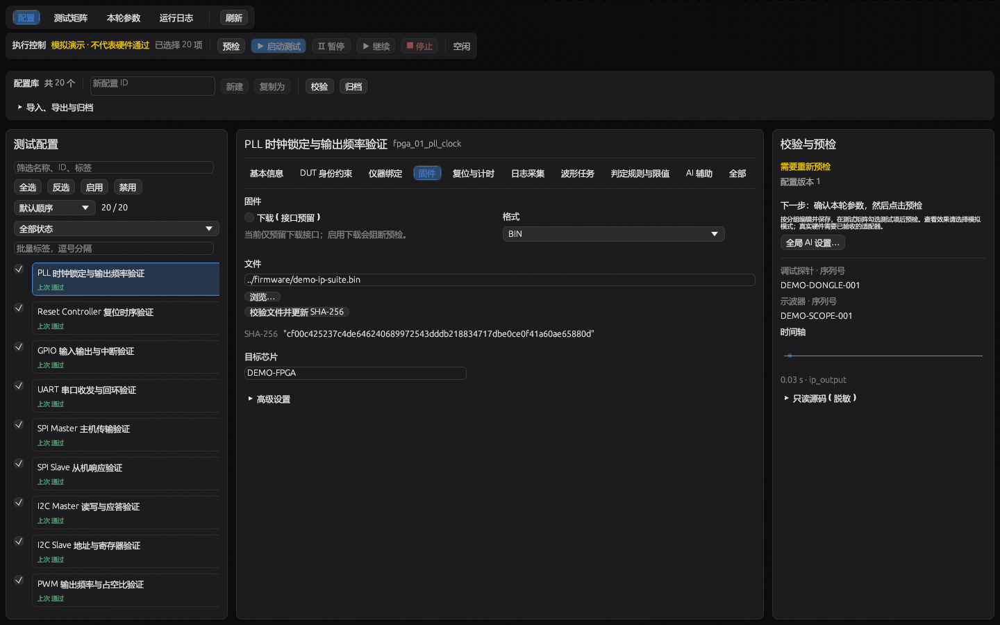
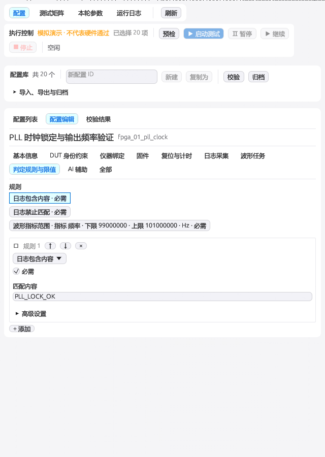
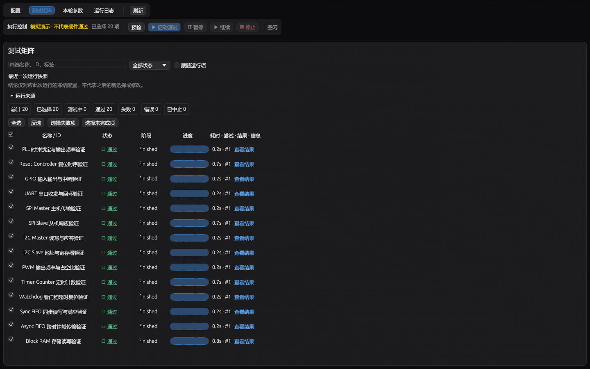

# Testing Hub 1.2.1 界面验收

以下图像来自实际egui绘制输出。测试包含两份代表性业务配置，112个源帧场景；图像绑定源码冻结哈希见 [evidence.json](evidence.json)。这是源码界面与交互验证，发行EXE运行验证另见发布记录。

规则采用摘要和当前详情，标识等技术项进入高级设置。

DC复位仅显示对应参数，确认方式和T0含义明确。

窄屏保留COM参数，Dongle专用字段不混入当前分支。

矩阵单独说明运行快照来源，旧结论不被当成后来修改或选择的结果。

