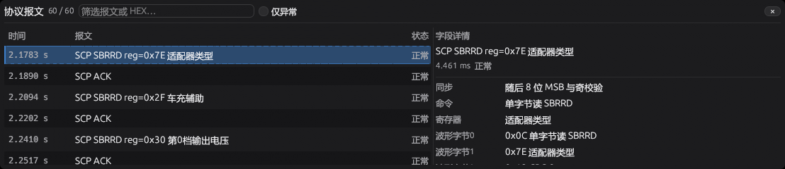

# 紧凑布局与协议报文区效果（2026-11-09）

本次为原 egui 框架界面调整，已于2026-11-09生成独立EXE预览版，之前的预览目录保持不变。

- 协议区：统一13 px正文、12 px时间/状态/字段名与14 px标题；独立时间/报文/状态表头，选中行标记，字段名与数值左对齐，减少三层堆叠。完整原始编码可悬停查看，字段区仍可滚动。
- 各页：公共组件间隙4 px，卡片内边距6 px；仪表分栏间距6 px，去掉重复的卡片后置留白；串口与AI分栏间距缩至4 px。控件操作高度保留28 px，列宽及对齐计算同步更新。
- 默认阈值：USB PD 0.4 V、SCP 1.0 V。解析引擎与界面共用默认常量；界面直接显示默认数值，显式手动阈值优先，UFCS原有自动阈值行为不变。

本轮按用户要求以编译和实际UI渲染为主，未跑全量回归。页面效果采自真实egui组件；SCP来自离线Normal.isf参考捕获（60条数据报文、218条PING）。阈值1.0 V的SCP捕获定向检查通过；USB PD默认值未追加实物仪器测试。仪表图为模拟设备，未执行真实输出控制。

协议区局部：

[完整波形页](waveform-protocol.png) · [示波器](scope.png) · [直流电源](dc.png) · [串口](serial.png) · [计算器](calculator.png) · [数据分析](data.png) · [测试报告](report.png) · [集成测试](testing.png)
