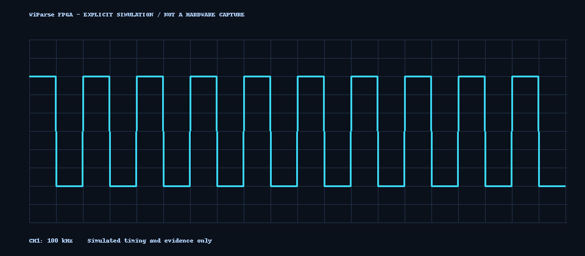

# FPGA验证 · 模拟演示

工程验证报告。执行状态与产品判定分别记录；工业审批状态：未批准。

运行 ID：394d1280-4c78-4163-a5bb-73b7de3679a4

|身份|本轮冻结值|来源|
|---|---|---|
|identity_source|simulation||
|operator|demo|run_parameters|
|input_at|2026-11-08T04:22:59.660Z||
|dut_serial|DEMO-SN-0001|run_parameters|
|board_revision|DEMO-REV-A|run_parameters|
|fpga_model|DEMO-FPGA|run_parameters|
|fixture_id|DEMO-FIXTURE-01|run_parameters|
|station_id|DEMO-STATION-01|run_parameters|

## 测试计划

本轮选择 1/20 项，计划 1 轮。未选择、未执行与已完成分别记录；本报告不将未测项目当作通过。

## 工程共享来源

工程：MT58xx验证；版本：1；SHA-256：e3c937182ae96661b0787a3b4a10447a4c01ab0eacdb23a8d701ef74bd45a1f9

DUT适用约束及仪器绑定来自冻结工程快照；本轮身份来源逐字段标记为用户输入或明确的模拟填充。

## PLL 时钟锁定与输出频率验证

26143986-6990-470b-a0ca-4c1102c787ee · completed / PASS

[完整结果与证据](../items/fpga_01_pll_clock/26143986-6990-470b-a0ca-4c1102c787ee/result.json) · [ip_output.source](../items/fpga_01_pll_clock/26143986-6990-470b-a0ca-4c1102c787ee/waves/ip_output-SIMULATION.csv) · [串口日志](../items/fpga_01_pll_clock/26143986-6990-470b-a0ca-4c1102c787ee/logs/serial.log)

限值 SHA-256：660a86c42762f3a18208efec990c1f2660c354d09ad36fccfaf72d01bbcc0a66

|规则|测量|下限|上限|单位|结论|限值来源|原因|证据引用|
|---|---|---|---|---|---|---|---|---|
|functional_success|1||||PASS||satisfied|logs/serial.jsonl|
|no_fatal_errors|0||||PASS||satisfied|logs/serial.jsonl|
|output_frequency|100000000|99000000|101000000|Hz|PASS|inline|satisfied|ip_output|

### 波形截图

共享配置 SHA-256：e3c937182ae96661b0787a3b4a10447a4c01ab0eacdb23a8d701ef74bd45a1f9；有效配置 SHA-256：30f6b10c278072ee7b34d4dd1241083742289c4c4dc1ef243e27e90b07b0346f

|实际角色|来源|实际绑定|
|---|---|---|
|programmer|project_config.instruments.programmer|{"kind":"debug_probe","serial":"DEMO-DONGLE-001","selector":{"serial":"DEMO-DONGLE-001"}}|
|scope|project_config.instruments.scope|{"kind":"oscilloscope","serial":"DEMO-SCOPE-001","selector":{"serial":"DEMO-SCOPE-001"}}|
|log_dongle|project_config.instruments.log_dongle|{"kind":"wiparse_dongle_uart","dongle_serial":"DEMO-DONGLE-001","uart_channel":0,"selector":{"dongle_serial":"DEMO-DONGLE-001","uart_channel":0,"baud":115200}}|

## 套件结论

产品结论：PASS；执行：completed；完成 1/1 个attempt。

## 执行覆盖

结束原因：计划执行完毕。未执行项不等于通过；未选中项不属于本轮计划。

|测试项|选择|计划次数|已归档次数|通过|失败|不确定|错误|停止|未执行|
|---|---|---|---|---|---|---|---|---|---|
|PLL 时钟锁定与输出频率验证 (fpga_01_pll_clock)|已选择|1|1|1|0|0|0|0|0|
|Reset Controller 复位时序验证 (fpga_02_reset_controller)|未选择|0|0|0|0|0|0|0|0|
|GPIO 输入输出与中断验证 (fpga_03_gpio)|未选择|0|0|0|0|0|0|0|0|
|UART 串口收发与回环验证 (fpga_04_uart)|未选择|0|0|0|0|0|0|0|0|
|SPI Master 主机传输验证 (fpga_05_spi_master)|未选择|0|0|0|0|0|0|0|0|
|SPI Slave 从机响应验证 (fpga_06_spi_slave)|未选择|0|0|0|0|0|0|0|0|
|I2C Master 读写与应答验证 (fpga_07_i2c_master)|未选择|0|0|0|0|0|0|0|0|
|I2C Slave 地址与寄存器验证 (fpga_08_i2c_slave)|未选择|0|0|0|0|0|0|0|0|
|PWM 输出频率与占空比验证 (fpga_09_pwm)|未选择|0|0|0|0|0|0|0|0|
|Timer Counter 定时计数验证 (fpga_10_timer_counter)|未选择|0|0|0|0|0|0|0|0|
|Watchdog 看门狗超时复位验证 (fpga_11_watchdog)|未选择|0|0|0|0|0|0|0|0|
|Sync FIFO 同步读写与满空验证 (fpga_12_sync_fifo)|未选择|0|0|0|0|0|0|0|0|
|Async FIFO 跨时钟域传输验证 (fpga_13_async_fifo)|未选择|0|0|0|0|0|0|0|0|
|Block RAM 存储读写验证 (fpga_14_block_ram)|未选择|0|0|0|0|0|0|0|0|
|DDR Controller 内存训练与访问验证 (fpga_15_ddr_controller)|未选择|0|0|0|0|0|0|0|0|
|AXI4-Lite 寄存器接口验证 (fpga_16_axi_lite)|未选择|0|0|0|0|0|0|0|0|
|AXI4-Stream 数据流与背压验证 (fpga_17_axi_stream)|未选择|0|0|0|0|0|0|0|0|
|DMA 数据搬运与中断验证 (fpga_18_dma)|未选择|0|0|0|0|0|0|0|0|
|Ethernet MAC 帧收发与校验验证 (fpga_19_ethernet_mac)|未选择|0|0|0|0|0|0|0|0|
|CRC32 数据校验计算验证 (fpga_20_crc32)|未选择|0|0|0|0|0|0|0|0|
