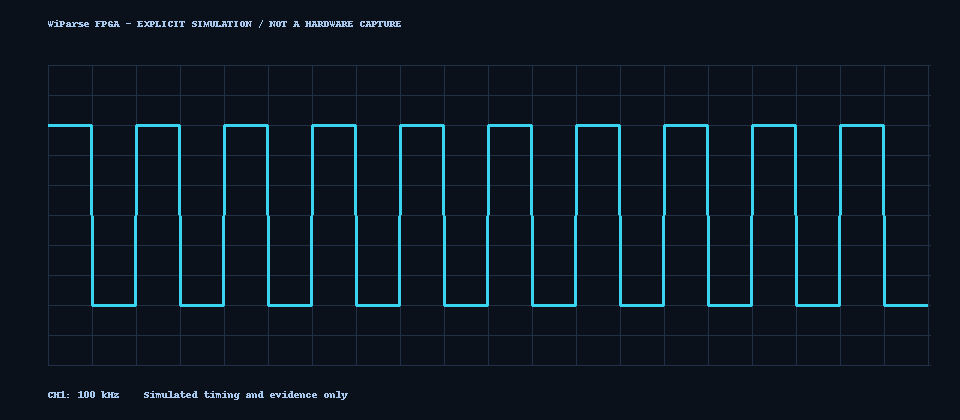

# 串口监控模拟报告

> 界面验证样本。全部数据为合成数据，图片为明确标记的模拟图，不用于判定实际产品合格。

## 1. 测试概况

| 项目 | 样本内容 |
| --- | --- |
| 测试类型 | 串口与波形呈现模拟 |
| 数据 | 120 行日志、2 通道 CSV |
| 标称波形 | 100 kHz，50% 占空比 |
| 仪器与 DUT | 未连接真实设备 |

[跳到波形证据](#2-波形证据) · [跳到日志分析](#3-日志分析)

## 2. 波形证据

截图应直接在正文中呈现，保持宽高比。



[打开波形源文件](scope-simulation.csv)

### 测量说明

CH1 在 0–5 V 之间切换，CH2 在 0–3.3 V 之间切换，采样间隔 0.1 µs。以打开后的实际数据为准。

## 3. 日志分析

- 合成日志覆盖 PING 和 CHARGING 两个状态。
- 第 81 行带有 `WARNING=timeout`，用于查看上下文与异常文本。
- 本例没有调用 AI，没有实际设备命令。

[查看原始日志](serial-simulation.log) · [返回概况](#1-测试概况)

## 4. 检查记录

- [ ] Markdown 标题层级与表格清晰
- [ ] 截图直接显示且不拉伸
- [ ] CSV 点击进入波形分析
- [ ] 日志链接在报告页打开并可返回

```text
SIMULATION ONLY — no hardware verdict
```
