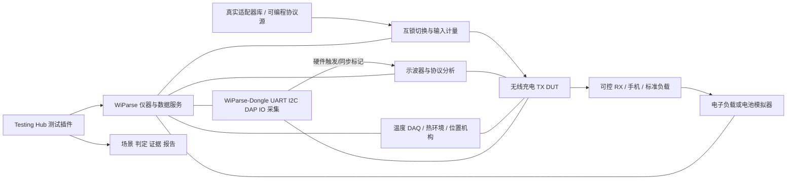

# WiParse 无线充电产品自动测试检验系统设计方案

日期：2026-10-10。设计修订：R2（工业可靠性复核）。核查基线：当前工作区 WiParse 1.1.27、HEAD `52ec6a6`。本文为设计与实施规格，测试项、拟议 API 和示例配置不代表已经实现。现有能力结论来自源码与插件契约核查，本轮未连接实物仪表或执行带电测试。第 16 节补充工业验收要求，冲突时以该节安全优先、完成确认和数据质量约束为准。

任务拆分（2026-10-11）：[总目标与跨任务契约](specs/wireless-test/00-system-contract.md)、[WiParse软件规格](specs/wireless-test/01-wiparse-software-spec.md)、[插件开发规格](specs/wireless-test/02-plugin-development-spec.md)、[Dongle开发规格](specs/wireless-test/03-dongle-development-spec.md)。各任务按共同需求ID、数据/接口和G0–G4门槛联合实施。

## 1. 目标与产品范围

建设一套面向研发验证、固件回归、适配器/手机兼容性、试产和量产筛检的自动测试系统。核心目标是快速复现问题、形成可追溯证据、对不同方案和固件做同条件比较，并为上市验证提供覆盖率依据。

默认 DUT 为无线充电发射器 TX，覆盖输入电源、前级升降压、桥驱动、线圈功率链路、Qi 通信和 RX 交互。RX 产品另设配置：增加整流输出、负载/电池充电链路和 RX 控制指标。手机作为黑盒兼容性对象；标准测试接收器作为可控、可计量的 RX。手机电量、系统温控和应用负载不可直接等同于发射器性能。

适用功率、Qi 配置、线圈数、拓扑、频率范围、输入协议、桥压范围、死区目标和温度限制由产品配置确定。不能把某个 Qi 版本或单一芯片的参数写成全产品硬编码。设计档包含 `product_profile`、`limits`、`station_profile`、`adapter_catalog`、`receiver_catalog`、`scenario` 六类版本化数据。

系统设置四种测试档：

| 测试档 | 目的 | 内容 |
|---|---|---|
| 开发快速验证 | 每次硬件/固件修改后快速定位回归 | 金样适配器与 RX、启动、VIN/VBRG、基本 PWM、通信、保护恢复 |
| 发布回归 | 固件或方案发布前全面验证 | 完整功能、边界、兼容性矩阵、热稳态、异常注入、统计重复性 |
| 长稳与兼容性 | 发现低概率和市场组合问题 | 真实手机/适配器/线缆、插拔、多口共享、位置偏移、长时间运行 |
| 生产筛检 | 检出装配/参数/校准偏差 | 短时启动、指定功率、频率、通信、关键电气和保护哨兵项 |

## 2. 现有集成测试与仪表能力核查

### 2.1 Testing Hub

当前 `test-tools/runner.mjs`、`lib/plugin-contract.mjs`、`lib/wiparse-sdk.mjs` 已形成 Node ESM 插件体系，支持 `preflight/run/stop`、通用参数表单、运行 overlay、项目/用例/结果目录及 `outputs[]` 产物展示。`scope-serial-monitor` 支持串口行触发后停示波器、截图和抓波形，可作为事件抓取的参考。

另有 Rust `testrun.rs` 计划执行器，支持 wait、wait_line、action、sleep、expect、instrument.command、waveform_source 等。适合短闭环验证，但目前不是带多维矩阵、回滚、结构化波形指标和分层判定的完整无线充电测试引擎。

建议以一个新的 Testing Hub 插件 `wireless-charge-validation` 承载测试编排，复用仪器 API 和证据路径，不把具体无线充电用例分支写入 GUI，也不同时启动两个竞争同一仪表的执行器。

### 2.2 支持范围及边界

| 类别 | 当前源码具备 | 本系统所需补充/核实 |
|---|---|---|
| 示波器 | Run/Stop/Single、通道开关/量程/偏置、时基、边沿触发、基本测量、截图、波形抓取 | 分段存储、完成状态查询、深存储/多通道一致性、脉宽/超时/逻辑触发、精细门控测量、型号级校验 |
| 示波器品牌路径 | Tek 含 MDO3000/3 Series 特殊路径；Rigol/Siglent 和 Keysight/Agilent 波形转换路径 | 具体型号、固件、选件、SCPI 行为及采样完整性须逐台验证，品牌识别不等于型号认证 |
| 直流电源 | 电压/限流、输出、OVP/OCP、测量、部分多通道估算 | 输出斜率、动态 list、硬件触发、远端补偿、设备真实额定范围查询 |
| 电子负载 | CC/CV/CR/CP、设置量、输入开关与读数 | 动态负载、list、触发、RX 负载步进及带宽验证 |
| 万用表 | 电压/电流/电阻/频率、量程、NPLC | 多通道 DAQ、温度、同步采样和校准元数据 |
| 调试与桥接 | probe 调试/内存/烧录/RTT、FT4222、WiParse dongle UART/I2C 等 | 产品寄存器语义、可靠遥测协议、只读监测与故障注入权限分离 |
| 通信 | 串口 ASK/FSK/Qi 消息、LiveBrief；波形 UART/I2C/SPI/I2S/DDSSS/USB PD/SCP/UFCS 解码 | 全捕获流式统计、传统 Qi ASK/FSK 模拟波形解调范围确认、被动解码与主动协议仿真分离 |
| 状态 | LiveBrief 中 idle/ping/id/cfg/pt/ept；ChargeStateTracker 用电池电压/电流估计 idle/trickle/cc/cv | 可配置完整 TX/RX 状态机、状态来源/置信度/时间窗、异常恢复路径 |
| 数据与报告 | 串口指标、电气数据、事件、原始波形、Markdown 报告及项目索引 | 统一时间轴、测量不确定度、结构化 verdict、矩阵统计、趋势与跨固件比较 |

重要缺口：`metrics.rs` 的固定指标结构有 VIN/IIN/VOUT/IOUT/VBAT/IBAT 等，没有明确的 VBRG、四路 gate、温度数组和硬件序列号；`charge_state.rs` 使用固定阈值及样本窗，不能作为各类产品统一验收依据。`ui.wave.bus` 面向 UI 设置，不能视为完整机器可读自动解码服务。现有显示预算与 LiveBrief 环形摘要也不能用作整场测试完整通信质量统计。

仪器 profile 的通用电压/电流/功率范围和能力声明主要按类型/品牌推定，例如通用 60 V/20 A/300 W 范围；必须用具体工位配置与型号实测收紧，不能用这些默认值保护实际小功率板卡。

## 3. 测试工位架构



工位按角色绑定设备：`input_source`、`adapter_switch`、`input_meter`、`scope`、`rx_fixture`、`rx_load`、`temperature_daq`、`positioner`、`dut_telemetry`、`protocol_analyzer`。运行前按序列号和能力匹配，运行中不能依赖上次连接产生的临时 device_id。

基础研发工位：现有示波器、受控直流源、电子负载、可计量 RX、UART、VIN/VBRG 与 PWM 探头。增强工位增加真实适配器切换、PD/PPS 等协议源/分析仪、温度 DAQ、位置机构。完整验证工位再增加环境箱、可编程 AC 输入、Qi 测试接收器/协议测试设备和异物测试夹具。

选型以能力需求为依据，暂不指定采购型号：动态电源需给出电压/电流/斜率/触发/读回范围；协议设备需支持产品声明的 PD/PPS/QC/SCP/UFCS 等模式和异常注入；并非所有产品都要求全部协议。

示波器通道计划至少包含两类采集：

| 采集配置 | 信号 | 时间尺度与用途 |
|---|---|---|
| 电源与周期 | VIN、VBRG、IIN/线圈电流、状态 GPIO | 长记录，检查启动、调压、跌落、保护和循环 |
| 单桥臂时序 | 同桥臂上管 VGS、下管 VGS、桥节点、相关电流 | 短记录高采样率，检查双向死区与交叠 |
| 通信 | CC 或 D+/D-、线圈包络/电流、同步 GPIO | 按协议采样率，检查协商和 Qi 通信 |
| 四路桥驱动 | 四路 VGS | 同时捕获四路，跨桥相位及两桥臂检查；电源监测另行同步 |

4 通道仪器无法一次同时覆盖上述全部信号。可分场景重复采集，但随机瞬态问题需要更多同步通道或共用硬件触发的多设备；报告必须标明是否为同一次事件。

## 4. 输入适配器兼容性设计

### 4.1 测试对象与矩阵

适配器库记录品牌/型号/序列号/固件、端口、额定功率、声明与实测档位、协议版本、认证/标识、线缆类型/长度/电阻/e-marker、多口负载状态、是否金样。

按产品支持范围建立分组：固定 5 V USB-A/BC1.2，Type-C 默认电流，PD 固定 PDO，PPS APDO，QC/FCP/SCP/UFCS 或其它声明协议；PD AVS/EPR 仅在产品实际支持时纳入。固定电源模拟用于电气边界，不能替代真实协议协商测试。无线 TX 是输入电源协议的受电方，协议源设备应模拟适配器 source，而不是错误使用 sink 触发器替代它。

维度包括：适配器/协议档位、功率能力、线缆/方向、RX 型号/功率、位置/间隙、环境温度、启动方式、多口共享。采用等价类与 pairwise 压缩一般组合；所有硬边界、高风险组合和历史缺陷组合强制完整覆盖。先通过可编程源做边界，再真实适配器做互操作。

### 4.2 主要场景

| ID | 刺激 | 检查点 |
|---|---|---|
| ADP-01 | 无 RX/有 RX 冷启动 | 初始安全电压、协商时长、合同档位、首次 PING、启动失败 |
| ADP-02 | USB-C 两方向、不同线缆 | CC/线缆约束、线压降、功率限制与正确降额 |
| ADP-03 | 功率不足/仅 5 V/不支持目标档位 | 合法回退、不反复协商、不宣称达到目标功率 |
| ADP-04 | 负载轻/中/满档与阶跃 | 合同与实测 V/I、VIN 低谷、输入限流和功率预算 |
| ADP-05 | 拔插、接触抖动、短暂掉电 | 输出终止/重启、VBRG 放电、恢复时间和重试次数 |
| ADP-06 | 电源跌落/慢升/纹波/限流 | UVLO、复位、振荡、过冲、保护恢复 |
| ADP-07 | 多口适配器插入第二负载 | 重新协商、掉电、中断、恢复及不会越过新功率预算 |
| ADP-08 | 可控拒绝/超时/复位/协议异常 | 重试上限、降级策略、事件原因和电气安全状态 |
| ADP-09 | 线缆压降随功率增加 | 源端电压与板端 VIN 分别计量，避免混淆 |

适配器兼容性判定包含“协商正确 + 电压电流合规 + 充电持续 + 异常恢复正确”。不能仅用进入 PT 或检测到 9 V 判定 Pass。

## 5. VIN/VBRG 控制、行为与充电周期

将请求值、寄存器/固件反馈值、物理测量值分别记录。VBRG 的定义是实际桥供电节点，不能与 VIN/VOUT 混用。产品可能没有独立可调 VBRG，此时配置映射为直接供电拓扑并删除不存在的控制判据。

VIN 指标：稳态值、峰峰纹波、欠压持续、启动/切换过冲、跌落恢复、输入功率、限流进入/退出、合同变化前后约束。

VBRG 指标：使能时序、设定跟踪误差、10–90% 上升/下降时间、超调/欠调、稳态波动、斜率、低频振荡、负载阶跃恢复、停止后残压与放电时间。所有指标带状态门控和时间窗，分别评估 PING、协商、功率传输、调压、EPT/保护、再启动。

设计三层状态机：

1. 输入供电：断开 → attach → 协商 → 合同有效 → 供电 → 重协商/故障。
2. 无线 TX：待机/扫描 → analog/digital PING → 识别/配置 → 协商（如适用） → PT → 降额/结束/保护 → 恢复。
3. RX/电池：未连接 → 充电建立 → CC/CV/终止/补充充电（仅有可靠电池遥测时启用）。

每次转换记录时间、依据、置信度、预期与实际下一个状态。日志声称 PT 但电气功率未建立时应标记不一致；出现 EPT 不一定是失败，应结合原因和场景判定。无法观测电池状态的手机只能判定无线供电行为，不能宣称完成 CC/CV 电池周期测试。

周期分开统计：上电启动周期、PING 重试周期、从建立 PT 到结束的无线会话、可重复的电池充电周期。测量启动成功率、PT 建立时间、单阶段超时、意外重启、重协商次数、主动结束原因、异常循环周期、恢复时间。

行为异常规则：持续 PING 却不能识别、反复 ID/CFG、PT 频繁退出、VBRG 调压来回跳、CE 长期饱和、功率与合同不一致、温控抖动、移除后不停止、通信丢失未保护。规则应有防抖、最短持续、状态例外和观测质量检查。

## 6. 关键波形自动检验

### 6.1 PING 和工作频率

从 PWM 或线圈电流提取有效边沿，迟滞阈值、最短脉宽去毛刺，按有效脉冲串分段。单周期频率 `f_i = 1/(t_(i+1)-t_i)`，不能把两个 PING burst 之间的空闲间隔算作 PWM 周期。报告 burst 内 f_min/f_max/中位数/P95/P99、周期抖动、占空比、脉冲数、burst 时长和 PING 间隔。

PT 按稳定段、调频段、负载突变段、温控降额段分别评估；扫频是控制方式时，应验证允许轨迹及边界，不能把调频全部当作抖动。配置定义每个状态的限值与屏蔽时间。

### 6.2 死区与交叠

分别测同桥臂 H→L、L→H：`dead_HL = t(L_on) - t(H_off)`，`dead_LH = t(H_on) - t(L_off)`，负值为门限定义下的交叠候选。另一桥臂独立统计。必须按匹配换向事件配对，排除 burst 边界、缺脉冲和异步停机，不能按最近任意边沿相减。

MCU PWM 死区与 MOSFET 实际开关死区分开判定。高侧测 VGS 必须以源极为参考；数字 PWM 不足以证明无直通。按器件/驱动定义 VGS 导通与关断门限，并联合桥节点、电流检查交叠尖峰、米勒误导通、异常振铃。未知阈值时输出“时序候选/待确认”。

探头传输延迟校正和通道 deskew 为必需元数据。设采样间隔 Δt、目标最短死区 d_min，工程初始选取 Δt ≤ d_min/10，并根据边沿带宽、噪声、插值误差和校准误差验证是否足够。分辨率或采集质量不足应输出 INCONCLUSIVE，不判 Pass。绝对值给 guard band：估计测量值 ± 不确定度跨越限值时不自动放行。

### 6.3 其它关键波形

增加 VGS 幅度/过冲/负压、最小脉宽、占空比/跨桥相位、软启动、桥节点振铃、线圈电流峰值/饱和候选、关断尖峰、PWM 丢脉冲、异常连续导通。高压/浮地节点使用额定共模与带宽合适的差分探头；硬件互锁及限流独立于 GUI。

高速短窗用于死区，长窗用于周期，慢速长期采样用于热和效率。不得用经过屏幕显示降采样的曲线做纳秒级判定。抓取后核查 XINCR、点数、数据格式、通道关联、采集 ID 和仪器实际模式，避免误用屏幕 NORM 数据或 min/max ENV 合并数据。

## 7. 充电过程、功率、效率与保护

| ID | 用例 | 输出 |
|---|---|---|
| CHG-01 | 空载扫描、放置 RX、建立 PT | 状态序列、PING、启动时间、协议与电气一致性 |
| CHG-02 | 低/中/高功率及 RX 动态负载 | 调节范围、稳定性、恢复时间、CE/RP 与功率相关性 |
| CHG-03 | 手机不同 SOC 与温度 | 会话功率轨迹、降额原因、中断与结束；记录手机热状态 |
| CHG-04 | 移除/重新放置/间隙/偏移/倾斜 | 停机响应、可充位置地图、误启和重启次数 |
| CHG-05 | OVP/OCP/UVLO/过温/通信超时 | 故障检测、停桥、残压、告警、恢复及锁存策略 |
| CHG-06 | 异物/FOD 场景 | 符合配置的测试物和姿态、停机时间、温升、误报/漏报；按正式规范作专门验证 |
| CHG-07 | 满充/接收器 EPT/补充充电 | 正常结束不误判失败、再次启动条件与空耗 |
| CHG-08 | 长时间满载/多次循环 | 热稳态、掉线、漂移、重启、性能随时间变化 |
| CHG-09 | 固件版本 A/B 与批次样品 | 同工况分布、差异、回归缺陷和统计显著性 |

功率计量定义边界：板输入 `P_in = mean(VIN(t)*IIN(t))`；受控 RX 直流输出 `P_rx = mean(Vout(t)*Iout(t))`；板输入到 RX 输出效率 `η = P_rx/P_in`。如评估适配器 AC 到 RX 效率需独立 AC 功率计。瞬态使用同时间窗，不以 `mean(V)*mean(I)` 代替存在相关纹波时的平均瞬时功率；手机内部 RP 或电池遥测只作关联证据，不能替代校准功率测量。

温度分别采板/线圈/MOS/外壳/环境/RX；热稳态以 dT/dt 和持续时间定义。长稳档关注失联率、降额占比及温升；测试时长和温度边界由产品规范确认。

## 8. 通信质量自动检查

输入协议与 Qi 通信两条链路分开统计。固件日志、独立波形解码、协议分析仪三类观测可交叉印证。

物理层：幅度、SNR/噪声、调制深度（协议相关）、边沿/振铃、符号/码片时序、时钟漂移。链路层：有效帧数、校验/奇偶/帧错、协议重试、重复帧、序号、ACK/响应时延、最长静默、丢通信后恢复。应用层：消息顺序、参数合法性、功率合同、CE/RP 周期、EPT 原因、协商升级/回退。

每项给分母及数据覆盖：`bad_frame_rate = rejected_frames / observed_candidate_frames`，并明确 candidate 定义；有序号时推断丢包，没有可靠参考时只能报告“观测到的错误率/间隔异常”，不能称真实 BER/PER。总线解码 CRC 成功不证明模拟信号裕量充足。

检测日志丢行、环形缓存覆盖、抓波形空洞、分析预算截断和解析器不支持消息。证据缺失、解码器失败与 DUT 通信异常分别标注。优先参考分析仪结果；使用已知良好/坏码/低幅度波形校准解析器，跟踪误报漏报。

USB PD 源能力/请求/合同/复位，SCP/UFCS 读写及状态应形成独立规范化事件。跨包重组、消息关联、Vendor 字段解析属于扩展；QC/FCP/BC1.2 主动识别和模拟不能从当前 USB PD/SCP/UFCS 被动解码直接推导。

## 9. 脚本组织与执行模型

推荐插件目录：

```text
test-tools/plugins/wireless-charge-validation/
  plugin.json                  # 参数、设备角色、outputs、report_name
  index.mjs                    # preflight/run/stop
  station.json                 # 工位连接与能力配置
  products/<product>/          # 产品拓扑、状态、limits
  catalogs/                    # adapters、receivers、cables
  scenarios/                   # 刺激与期望序列
  suites/                      # smoke、regression、interop、soak、production
  lib/                         # orchestration、checks、report、evidence
```

测试步骤标准化为：准备/能力校验 → 置安全初态 → 武装示波器/日志 → 施加刺激 → 等待可观测条件 → 收集 → 数据质量检查 → 指标/状态判定 → 归档 → 回到安全态。事件刺激必须在采集武装完成后；不要日志命中后才停示波器而假定包含事件前沿，需预触发记录或分段采集。

执行模型采用有限状态机、deadline、取消 token、设备独占 lease、显式 cleanup。异步 `accepted/job_id` 仅表示已排队，必须关联完成事件和错误；HTTP 超时后命令可能继续执行，不得盲目重试输出控制。重新连接后确认真实输出状态。危险异常立即执行独立硬件保护和经验证的安全停机；并行尝试冻结预触发记录，证据导出不阻塞保护。确认输出关闭、残压达标后再完成归档和释放设备。一般测试失败按产品拓扑配置受控停止顺序，禁止先关负载造成不受控电压上升；硬件过流/过温/急停独立执行。

软件故障输出 ERROR，供电等保护失败输出 FAIL，缺测输出 INCONCLUSIVE，不适用输出 SKIP；Pass 需所有必需项完成且覆盖满足。GUI 插件信封 `ok` 只表达执行是否成功，产品结果另置 `verdict` 与各 check，禁止将进程 exit 0 当作产品合格。

用例配置示意（为拟议 DSL，不可直接投入现有 runner）：

```json
{
  "schema_version": "wcv-design-1",
  "case_id": "PWM-DEADTIME-01",
  "profile_ref": "products/tx_sample@revision",
  "required_capabilities": ["scope.raw_multichannel", "scope.deskew"],
  "conditions": {"adapter": "golden_pd", "receiver": "controlled_rx", "load_profile": "rated"},
  "capture": {"profile": "bridge_leg_a", "hardware_trigger": "sync_gpio", "raw": true},
  "checks": [
    {"metric": "deadtime_hl_min", "limits_ref": "pwm.deadtime_hl", "quality_ref": "metrology.timing"},
    {"metric": "deadtime_lh_min", "limits_ref": "pwm.deadtime_lh", "quality_ref": "metrology.timing"},
    {"metric": "shoot_through_candidate_count", "limits_ref": "pwm.overlap"}
  ],
  "on_failure": "preserve_raw_and_safe_shutdown"
}
```

限值设为产品评审批准值：建议初期全为空或 `unapproved`，预检阻止验收档运行。不得用示例数字覆盖 MOSFET/驱动/协议规范。每条限值记录单位、比较方式、状态窗、来源/条款、版本、批准人、guard band、适用工况。

## 10. 数据、报告和问题定位

沿用项目规范：`projects/{project}/tests/{report_name}/runs/{stamp}/artifacts/{output_id}/`。每轮保存 `run.json`、锁定配置及 SHA-256、固件/硬件/BOM、DUT 与仪器序列号、驱动/解析器版本、校准与探头配置。

建议 outputs：`reports`（summary.md 与 JSON）、`waves`（原始 ISF/WFM/CSV）、`logs`（串口/协议）、`metrics`（CSV/JSONL）、`shots`、`manifest`。机器结果至少包含 case、condition、metric、value/unit、window、limit/source、quality、uncertainty、verdict、evidence、reason_code。

统一时间轴：仪器采样相对时间 + 采集触发时间；遥测记录 DUT tick/序号 + 主机单调接收时间 + UTC。通过同步 GPIO/触发/已知事件估计偏移和漂移。主机收到日志的时间不等于事件发生时间，不能据此判几十纳秒因果。

报告包含覆盖矩阵、必需未测项、风险摘要、失败首次时间/重复次数、关键波形片段、状态转换、通信和电气关联。自动归因分层为“现象 → 支持证据 → 候选原因 → 建议复测”；例如 VIN 跌落先于 reset 支持输入供电候选，但不能只凭时间相近确认根因。

既保留首次失败，也保留复测结果，重试不得抹掉失效率。小样本零失败不等于百分之百可靠：独立同分布条件下零失败 n 次，可用约 3/n 估计 95% 单侧失败率上界；长期相关试次不能机械套用。

数据策略：正常段可保存摘要与代表波形，首个及不同签名故障保留原始高分辨率数据；长稳限制缓存/磁盘，流式落盘，manifest 明示丢失段。维护可离线回放的金样库，复测算法而无需带电重复。

## 11. WiParse 扩展与增强建议

以下名称为拟议接口，不能在当前版本直接调用：

| 优先级 | 扩展 | 验收标准 |
|---|---|---|
| P0 | 型号级能力探测与能力自检 | 实际量程/采样/触发能力读回；不支持时拒绝运行；工位探头/额定限制生效 |
| P0 | job 完成、取消、状态与设备 lease | 命令完成唯一关联；超时与断线不重复刺激；两个测试不能争用输出 |
| P0 | `wave.analyze`/离线批量分析服务 | 路径+通道+时间窗入参，异步 job；频率/死区/纹波结构化结果；无需点 GUI |
| P0 | 全量流式 `protocol.decode` | 统计与显示解耦，支持长捕获/时间窗，不因显示预算丢失计数；输出质量与未支持字段 |
| P0 | 产品状态机与 verdict 引擎 | 状态门控限值、PASS/FAIL/ERROR/INCONCLUSIVE/SKIP；错误数据不自动放行 |
| P0 | 遥测 schema 与时钟映射 | VIN/VBRG/温度/寄存器/故障/序号独立字段；缺失/单位/时间同步校验 |
| P1 | 动态电源/负载、协议设备、切换器驱动 | 源端与线缆/负载能力受限，切换互锁，支持 PD/PPS 等声明协议 |
| P1 | 示波器深存储、多通道原始同步、分段触发 | 获取真实点数/时间基准/采集 ID，区分 screen/raw/ENV，坏数据被阻止用于死区 |
| P1 | 通信链路与会话分析 | 合同、重试、超时、完整分母、跨包重组、独立分析仪交叉比对 |
| P1 | 测试矩阵与回放回归 | 场景扩展、覆盖率、配置冻结、金样/异常波形和结果可重复 |
| P2 | 温控/DAQ/位置机构/电池模拟器 | 偏移地图、温度闭环、可靠 CC/CV 测试 |
| P2 | A/B 比较与生产档 | 固件/批次对比、限值治理、GR&R、工位漂移与产线数据导出 |

波形计算建议置于 Rust core 共用库，插件只编排；时间统计、门限质量、deskew、频率、死区和协议都输出统一 `MeasurementResult`。GUI 复用同一分析结果，防止 UI 与自动化得到不同判定。新型号驱动需 transport mock + SCPI transcript + 实物标准用例，不能只测字符串发出。

## 12. 分阶段落实与验收

阶段 0：需求冻结与工位确认。交付信号/接线图、产品限值表、适配器/RX 清单、工位能力自检、金样基线。验收：能确认每项可测/不可测，危险输出与仪表量程有独立限制。

阶段 1：最小闭环。实现插件骨架、设备角色/lease、结构化 verdict、VIN/VBRG、PING/PT 频率、基础状态/通信和异常证据；选一台已验证示波器和一套受控 RX。验收：已知正常、断电、启动失败、缺数据四种回放与实测得到正确类别。

阶段 2：时序与适配器兼容。完成实际 VGS 双向死区、raw 多通道、deskew 质量、协议源/真实适配器矩阵、动态刺激与恢复。验收：已知间隔/交叠信号能校准算法，故障注入不被重试掩盖。

阶段 3：完整开发验证。加入热、位置、FOD、长期会话、协议关联、金样库和固件 A/B。验收：历史故障有用例、必需覆盖清楚、同数据重复分析一致、工位重复性可接受。

阶段 4：生产档与上市流程。选出与研发缺陷高相关的短筛检项，做测量系统分析、golden unit 开班检查、序列号追溯和版本锁定。验收：误判/漏判、节拍、追溯与异常复核流程经试产验证。

工期不在未知产品/设备条件下做承诺。正式排期应按“仪器与夹具到位、规范获取、固件遥测、真实手机控制能力、带电验收资源”评估。最先做结构化测量与可复现证据，再扩充设备数量。

## 13. 上市验证与标准依据

自动系统用于内部验证、预符合性和生产检验。涉及 Qi/Qi2 标识时，需要按目标配置和规范版本走 WPC 的符合性/互操作与认证流程；支持的功率档位和认证配置不应凭当前解析器支持决定。USB-C/PD 合规按目标产品的角色与对应 USB-IF 测试要求确认；消费类上市还应建立目标市场 EMC、安全、温升、环境/可靠性及法规验证清单，由相应实验室/合规负责人落实。内部脚本报告应明确测试依据和适用范围。

参考官方来源（2026-10-10 查询）：

- WPC 标准与认证体系：https://www.wirelesspowerconsortium.com/standards/
- WPC 测试与互操作资源：https://www.wirelesspowerconsortium.com/knowledge-base/testing-and-certification/cost-of-certification/
- USB-IF Type-C 测试资源：https://www.usb.org/usbc
- Tektronix 电源测量与 deskew：https://www.tek.com/en/documents/application-note/power-supply-measurement-and-analysis-3-pwr
- Tektronix 电源节点探测：https://www.tek.com/en/documents/application-note/probing-techniques-accurate-voltage-measurements-power-converters-oscillos

本地核查入口：`test-tools/PLUGIN_SPEC.md`、`runner.mjs`、`plugins/scope-serial-monitor/loop.mjs`、`lib/wiparse-sdk.mjs`、`crates/wiparse-core/src/instrument/drivers.rs`、`metrics.rs`、`charge_state.rs`、`brief.rs`、`testrun.rs`、`bus_decode/`、`crates/wiparse-gui/src/backend/capabilities.rs` 与 `instrument_control.rs`。

## 14. 实施前必须冻结的信息

1. DUT TX/RX 类型、额定功率、Qi 配置、线圈/桥拓扑、输入协议/档位和可调 VBRG 范围。
2. 硬件/驱动允许的 VIN/VBRG/VGS/电流/温度与时序限值，以及目标法规/认证。
3. 仪表型号/固件/选件、探头/deskew、设备远程协议和可用同步触发。
4. 可控 RX、真实手机、适配器/线缆清单及位置/温度控制范围。
5. DUT 遥测与控制协议、故障码、看门狗/复位原因、固件日志时间戳。
6. 每类用例重复次数、长稳持续、判定置信度、生产节拍及数据保留政策。

这些信息缺失时可以开发框架与离线算法，但产品验收档不得自动出具“全部合格”。

## 15. WiParse-Dongle 作为统一数据采集端口的方案调整

根据补充需求，Dongle 规划支持 I2C/UART/DAP-Link 和 IO 中断捕获，配合示波器等仪表采集实时数据。调整后 Dongle 是常驻采集与事件关联节点，示波器是高速模拟波形证据节点，仪表承担电源/负载刺激及独立计量，WiParse 承担归档与分析，Testing Hub 插件编排用例。

当前仓库能核实 UART、I2C master RPC、DAP/RTT 路径；未找到可确认的 IO 时间戳流、捕获任务、溢出统计或示波器触发接口，故 IO 部分按开发中能力设计，不预设已经可用。下面的采样/触发参数是验收需求，不是对现有 Dongle 性能的声明。

### 15.1 四种接口分工

| 接口 | 推荐用途 | 设计边界 |
|---|---|---|
| UART | 持续输出 VIN/VBRG/温度/控制状态/故障/协议消息 | DUT 时间戳和序号优先；当前透传字节本身没有事件时间戳，USB 分包到达时间只能表示接收时间 |
| I2C | 低频状态/寄存器快照、故障后读回、受控参数设置 | 当前为主动 master，不是被动总线嗅探；DUT 已有主机时需专用调试接口、多主机验证或改走 DUT UART 快照服务 |
| DAP-Link/RTT | 固件烧录、版本识别、非停机日志、开发问题现场读取 | 正常性能测试避免 Halt/单步/复位；RTT/内存读取也要验证总线负载和时序干扰，不能假设完全无侵入 |
| IO 捕获 | PING/PT/EPT/FAULT/RESET/同步标记的硬件事件时间、事件顺序和间隔 | 普通 ISR 时间戳只能测其可验证精度；高速 PWM/死区用硬件定时器捕获/DMA或示波器，不把 IRQ 处理延迟当真实边沿时间 |

建议 DUT 固件提供可选测试遥测协议：固定字段版本、单调 tick、seq、状态、VIN/VBRG 请求与反馈、IIN、温度、频率/占空比/死区请求值、故障位、复位原因和 Qi 消息事件。把 ADC/寄存器反馈与物理仪表测量分开存储。必要的事件 GPIO 由状态转换或故障路径产生；限制日志与打点开销，量化开启/关闭测试遥测后的性能差异。

推荐首期 IO 映射（引脚数量按硬件选择）：同步标记、PT_ACTIVE、FAULT、RESET 或 PWM_ENABLE；PING 可与状态编码/事件脉冲组合。单根复用脉冲必须有明确编码与最长脉冲/间隔约束，不能含糊按脉宽猜状态。

### 15.2 实时链路与时间基准

区分三个指标：边沿时间戳精度、事件到主机可见延迟、波形抓取完成延迟。USB/WiFi 实时到达不意味着纳秒级同步；几十秒的波形导出也不影响已冻结波形的采样精度。每种接口分别记录质量。

1. Dongle 使用同一自由运行硬件计数器标记 IO 事件及 UART 接收块；优先定时器输入捕获，必要时 DMA。计数器扩展为 64 位并声明频率、分辨率、溢出方式与晶振误差。
2. 每次上电提供唯一 boot_id，每次 capture 提供 session_id，每个事件/块有 seq。断线恢复不得把新会话接在旧时间轴上。
3. UART 字节跨块保持原始顺序；主机解析一帧后保留接收区间。若 DUT 也有 tick，通过同步事件映射 DUT tick 与 Dongle tick，不把接收末尾时间当作帧产生时间。
4. 与示波器同步优先把同一物理信号分送 Dongle capture 和 scope trigger/通道，或增加 Dongle 硬件标记输出。若现有 IO 仅输入，这个输出是明确硬件/固件扩展。
5. 开始与结束都有同步标记，长期运行周期性标记，用于拟合偏移/漂移，记录残差。跨设备不能只用一次 NTP/主机时间同步替代。

新增字段示意：`schema_version, dongle_serial, boot_id, session_id, channel, seq, tick, tick_hz, event_type, payload, quality_flags`。IO 事件额外记录 pin/edge/level；UART block 记录 first/last tick 与 bytes；I2C 记录 request/start/end/transaction_id/result。USB 可靠传输仍需帧长度与序号检查，是否额外 CRC 由 ICD 规定，不自行声称 USB 数据完全不会丢失。

### 15.3 示波器触发和连续采集配合

标准顺序：配置通道/时间窗/触发 → Dongle 采集 ready → 示波器 armed 读回 → 施加刺激 → IO 事件/标记 → 示波器硬件触发 → 等待采集完成 → 冻结并导出 → 关联 capture_id 与事件。异常前波形依赖预触发环形记录，不能等 WiParse 收到 UART 错误后才开始抓取。

若只能软件触发，明确标为软件关联模式，量化延迟及抖动，只适用于较慢事件。IO ISR 接收边沿后再通过软件翻转 trigger_out 的路径也存在延迟，必须测定；高精度优先共享信号或硬件路由输出。

频繁故障用分段示波器/有限事件队列；波形导出期间 Dongle 继续采集，使用独立缓冲和流式落盘。若仪器不能边导出边采集，记录盲区与触发丢失数，禁止把空白段计为正常运行。高频每个 PWM 边沿不经主机逐个触发，Dongle 可先本地统计或定时器捕获短窗，示波器保存关键窗口。

### 15.4 固件缓冲、带宽与接口契约

提供控制面、数据面和急停/健康状态；数据与 DAP 请求避免共享无界队列。IO 时间戳捕获与 UART 接收任务不能被 I2C 超时、WiFi 重连、烧录或报告请求长时间阻塞。

容量按最坏情况计算：`R = Σ(event_rate × record_bytes) + UART_bytes_per_s + framing_overhead`；8N1 UART 2 Mbaud 的理论数据量约 200 kB/s（未含封装），115200 约 11.52 kB/s。例如四路各 200k edges/s、每事件 16 B，单 IO 就约 12.8 MB/s，不能假定现有 USB/MCU/FIFO 足够。USB 总线速率与端点实际吞吐分别确认。

缓冲需求至少为 `R_peak × 最坏主机服务停顿时间 × 裕量`，加事件预触发空间；超过可用 RAM 时采用速率限制、本地统计、筛选或短窗捕获。必须返回总捕获数、发送数、dropped、overflow、UART framing/overrun、I2C busy/timeout、队列水位及最长服务间隔。实时不可回压事件发生溢出时记录丢失区间，不能静默覆盖。

建议 USB 为研发高可靠主链路，WiFi 为远端使用选项并标明延迟/丢失/重连质量。当前 UART 的 auto 回退可能切换 USB/TCP；正式测试应锁定 transport，切换时生成事件并重新同步，不能无提示继续计量。

保留已有 DAP/UART/I2C 接口兼容；新增 IO capture 走独立版本化接口或明确多路复用通道，不随意占用现有 MI/endpoint/TCP 端口。本仓库已有 MI_00 DAP、MI_01 UART、MI_03 I2C，扩展接口编号需结合固件完整 USB 描述符与其它功能协商，不能只按此列表分配。

拟议设备协议包括 capabilities、capture.configure/start/status/stop、stream.read、clock.info、sync.mark、health。配置读回 pins/edges/filter/tick_hz/queue 等；新增 `dongle.capture.*` WiParse API 属拟议能力，当前不可直接调用。

### 15.5 接入与测量侵入性

I2C READ 可能读取后清零状态或访问分页寄存器，因此只读并不等于无副作用。产品 register map 标记 read-to-clear、原子性、读取顺序与白名单；故障快照优先 DUT 锁存后输出，避免错过瞬态。

正在由 DUT 控制的 I2C 总线，禁止 Dongle 无条件 SCAN；非多主机系统优先额外调试端口。若需被动嗅探，应增加独立设计，不能混用现有 master RPC。轮询频率按总线占用预算和样本一致性确定。

Dongle IO 使用额定电平、输入保护与可选隔离，桥压、线圈或高侧 gate 不直接连接 MCU IO；高侧 VGS 交给差分测量。故障判停由硬件保护实现，Dongle/Windows 在线健康监测不承担唯一安全保护。

### 15.6 调整后的优先级与验收

P0：先冻结 Dongle 采集 ICD、公共 tick/seq/boot/session、丢失检测和 UART 原始流；实现 IO 硬件时间戳与 capabilities，再建立 WiParse 常驻 Dongle 采集服务。GUI、插件和日志查看共用服务，避免多个客户端争抢 UART、DAP/RTT 或 I2C。

P0：同步输入/输出和示波器 armed/completion/job 关联；统一遥测 schema、质量标志和离线回放。优先做 VIN/VBRG + 状态 GPIO + UART 的最小闭环，PWM 死区继续由示波器原始 VGS 分析。

P1：I2C 白名单快照、RTT 受控读、定时器短窗 PWM 统计、事件规则与异常片段；P2 再扩适配器协议源、位置与热环境。

验收应包含：已知脉冲发生器与示波器交叉时间校准、最高目标事件率长稳、IO/UART/I2C/RTT 同时工作、USB/网络断线、主机卡顿、缓冲溢出、计数器回绕、Dongle 复位、触发频繁超过波形导出能力。每类故障必须可见且能定位丢失区间。实时精度按实测分布和上界声明，不按 MCU 时钟频率或理论中断速度声明。

针对主机调度、串口到达和软件中断不可预测的情形，验收档使用“观测精度不足/采集不完整”结论；经过同步与质量验证后，再启用事件因果和自动判定。Dongle 方案可明显提高会话监测和故障关联能力，但实际门极波形、输入功率和模拟通信质量仍由对应测量设备给证据。

## 16. 工业可靠性复核与强制验收要求（R2）

### 16.1 复核结论

R1 功能覆盖较完整，但不足以直接批准无人值守或生产放行。缺少可验证的异常响应上界、完整恢复事务、独立采集保活、故障处置规范和测量系统验收。R2 补齐设计要求；达到工业使用条件仍需具体设备、固件、夹具和软件的联合故障注入验收。这里的“强制”指本项目内部工程门槛，不表示已满足某项 IEC/ISO 标准或取得认证。

| 发现 | 风险 | R2 修正 |
|---|---|---|
| 保存证据先于安全停止 | 波形导出/磁盘故障延迟切断危险输出 | 保护优先，冻结记录与保护并行；导出在确认安全后完成 |
| 使用 GUI 主进程承担采集 | GUI 卡顿/崩溃同时丢采集和控制 | 采集/设备服务独立进程；本地缓存；独立硬件 watchdog |
| 只有采样率而无捕获上界 | 短事件漏捕，告警过迟 | 明确最短事件、最密事件、延迟预算、覆盖盲区及验收方法 |
| lease 未说明过期命令如何失效 | 重连后旧命令重新上电 | session epoch/fencing、输出命令状态读回、隔离未知状态 |
| 错误只分类没有处置路径 | 操作员重复尝试、误以为 DUT 坏 | 统一错误码、首因、处置卡和有限自动恢复 |
| 屏蔽窗与重试不受约束 | 硬故障被忽略，重试抹掉失效率 | 保护独立生效；屏蔽范围可审计；保留首次失败 |
| 测量/统计只有原则 | 稳定偏差或小样本假通过 | 测量不确定度、校准、GR&R、坏样验证与样本计划 |

### 16.2 独立保护、采集与编排

工业目标架构为四层：硬件互锁/保护 → Dongle 本地事件捕获 → 独立设备与采集服务 → 插件编排和 GUI。现有 GUI 托管 API 可用于研发过渡阶段；在进程隔离、watchdog 和故障注入验收完成前不作为无人值守放行架构。

硬件保护不依赖 GUI、Node、USB/WiFi、磁盘和示波器导出。输入切断、限流、过温、急停与触点/残压反馈形成可验证闭环。watchdog 失联进入配置的安全态；保持某输出才安全的拓扑须专门定义。不能默认电源收到 OFF 就已断能。危险异常锁存，恢复供电必须核实原因、互锁、残压、输出和采集状态；需要人工复位的故障不得自动清除。

适配器切换采用 break-before-make：撤销刺激/切断 → 放电达标 → 确认旧通道断开 → 切换并确认唯一通道 → 新采集 ready → 新供电。故障如粘连或未知反馈进入隔离，不继续其它适配器用例。禁止多个适配器输出并联。

采集服务断开 GUI 后继续落盘并保留状态；编排失联时禁止新刺激并执行适用安全策略。服务自身崩溃由硬件保护兜底，重启后先检查真实输出与未完成 run，标为 interrupted，不能自动接续带电动作。

### 16.3 异常捕获的时间预算

每类事件必须定义：`minimum_pulse_width`、`minimum_interarrival`、`burst_rate`、持续率、同步误差、预触发/后触发时长、最大允许检测/保护延迟、证据完整度和告警延迟。这些字段未批准时预检拒绝相应验收用例。

| 路径 | 时间要求与验收 |
|---|---|
| 直通/硬过流/危险过压 | 保护响应上限来自器件安全工作区与产品风险分析；硬件执行。用同步波形测刺激到实际切断，主机告警不参与保护预算 |
| IO 事件 | 测输入同步器、滤波、捕获、DMA和缓存全部延迟；最窄合法脉冲、边沿临界相位和最大 burst 均注入；去毛刺门限不得超过待检异常最短脉宽 |
| UART 状态/故障 | DUT 生成延迟 + 串行传输 + Dongle 缓存 + 服务消费 + 判定；DUT 停机不再发日志时仍需 IO/物理监测观察 |
| 主机事件告警 | 建议初始可用性目标：正常批准负载下事件可见 P99≤250 ms；健康检测周期≤100 ms、连续失联≤500 ms进入告警/禁止新刺激。均为待实测工程目标，不是硬实时保证或保护时限 |
| 波形证据 | 在刺激前 ready/armed；按目标事件前后因果窗设置原始记录，验证触发延迟、holdoff、分段数量和重武装时间 |

单次共同触发只能对齐起点，不保证长期采样频率一致；需共同参考时钟或周期标记修正漂移。若要求小于同步残差的因果关系，结果必须 INCONCLUSIVE。

分层捕获：持续低速遥测/健康监控 + Dongle IO 全事件 + scope 高速预触发环 + 少量关键事件完整导出。对随机模拟异常必须有独立模拟触发/峰值锁存等观察路径；缺少 FAULT GPIO 不可假定不存在故障。

稳定态正常触发可限流、去重；保护事件不可因去重取消计数与首个证据。配置 `max_export_queue`、内存/磁盘水位和队列最旧年龄；触发风暴时先确保安全、保留首因及计数，记录所有缺失/盲区，不声称保存了全部波形。

若单段长度 W、重武装/导出盲区 B，不得仅以 W/(W+B) 宣称随机故障检出率，须结合事件分布、触发条件和同时独立观察验证。报告给出实际覆盖时间、盲区时间线、触发接受/丢失数。必需事件证据丢失导致该项 INCONCLUSIVE，硬件实际越界证据存在时仍保留 FAIL。

### 16.4 顺畅执行与恢复事务

用例状态固定为 CREATED → VALIDATED → RESERVED → SAFE_READY → ARMED → STIMULATED → OBSERVING → SAFE_STOP → ANALYZING → COMMITTED。任何阶段可进入 ABORTING/QUARANTINED；每个转换都有前置条件、deadline、幂等/重试类别和审计记录。分析与导出可并行，但安全状态未确认不得释放设备或开始下一轮。

预检一次核对版本/能力/序列号、批准限值、接线/探头、校准、磁盘容量、输出初态、接收器与适配器状态。每用例再做短检查：独占权、互锁、已冻结配置、捕获 ready、时间同步质量。用稳定条件和状态读回替代长固定 sleep；读取可有限重试，切换/上电/故障注入不可盲重试。

请求携带 run_id、step_id、command_id、session_epoch 和 deadline；服务对重复 command_id 去重，拒绝过期 epoch。API 回包、SCPI写成功、job完成、实际输出达标是不同阶段，均按需确认。命令超时进入 UNKNOWN_PENDING，查任务及物理状态，必要时硬件安全停机；不能直接再次上电。串行 SCPI 查询超时还需清除/重建会话，防止迟到响应被当成下一条读数。

旧进程必须在设备服务侧被 fencing 拒绝，单靠文件锁/lease TTL 不足。硬件不支持 fencing 时，服务保证唯一连接与新会话前安全复位；无法确认则隔离。

磁盘日志追加和 run 状态提交采用 crash-consistent 流程：周期刷新、临时文件原子替换、完成 manifest 标记、校验关键产物后才 COMMITTED；明确最大允许掉电丢失窗口。原子重命名不等于物理持久化，须验证目标文件系统的实际刷新策略。容量不足时在新刺激前停止；测量服务独立记录最小故障摘要。

操作员界面展示当前阶段、DUT/适配器、等待条件/剩余时间、采集健康、保护状态、异常首因与唯一推荐操作；停止按钮立即发起取消，不等待当前报告生成。维护/接线/换手机只在安全状态提示，不允许普通弹窗阻塞 watchdog 或捕获。

### 16.5 错误码、首因与处置

每条异常包含 error_id/code、来源层、严重度、run/case/step/device/capture_id、单调时间与 UTC、观测值/期望值、质量、关联证据、自动动作、剩余重试和处置指引。第一异常锁定为首因，随后 SCPI timeout、USB断线等列为后果或待关联，不能覆盖首因。因果未经证明仍标候选。

| 错误码示例（拟议） | 动作 | 快速识别/处理 |
|---|---|---|
| SAFETY.OVERCURRENT / INTERLOCK | 硬件保护、锁存、隔离 | 直接显示刺激与切断波形、保护反馈；人工核查接线/板卡后复位 |
| DUT.START_TIMEOUT / RESTART_LOOP | 安全停止、保留首次失败 | 显示缺失状态、VIN/VBRG、协商/复位原因；按供电→协议→控制链复测 |
| ACQ.OVERFLOW / CLOCK_LOST | 禁止新刺激、标记受影响指标不确定 | 显示丢失区间、队列水位、同步残差；减采集负载或修接口后重跑独立 attempt |
| DEVICE.TIMEOUT / OUTPUT_UNKNOWN | 查询任务与输出；不明时硬件停机 | 显示最后命令、截止时间、真实反馈；清理会话后安全自检 |
| DATA.DISK_FULL / WRITE_FAILED | 禁止新刺激、受控停止 | 显示空间/写入错误及证据保存状态；恢复存储后创建新 attempt |
| ANALYSIS.UNSUPPORTED / QUALITY_LOW | 保留原始数据、INCONCLUSIVE | 提示未支持协议/分辨率/校准项；更新算法或采集配置后回放/复测 |

错误解决后执行对应恢复自检，不靠用户点击“忽略”重新变成绿色。自动恢复仅适用于经过验证的瞬时通信/读数故障，有次数与总时间上限；同类错误反复出现触发工位隔离。产品故障与基础设施故障同时保留：run execution_status 和每项 product_verdict 分开输出，ERROR 不得覆盖已确认 FAIL。

### 16.6 误判控制与测量系统验证

给每项指标建立不确定度预算：仪器/探头校准、增益/偏置、带宽、采样与插值、门限/噪声、deskew、时钟漂移、夹具与温度。校准过期、探头更换、量程变化、异常自检或工位维修触发重新验证。参考值需独立且不与被测算法共享同一错误来源。

启动/调压屏蔽窗只能屏蔽批准的性能规则，不屏蔽绝对电气保护、数据缺失和安全事件。所有窗保存起止、理由、规则和版本。测量越界须保留极值，不能用平均值遮盖单次死区交叠/过压。

金样不能替代坏样：验证正常、边界、明确故障、缺数据、时间错位、单位错、伪正常日志、错误通道、反接/未接探头；用已知参考波形和独立仪器交叉检查。每条规则给灵敏度、误报/漏报验收集及风险权重。

生产前做样品×重复×工位/操作者的测量系统分析，评估重复性、再现性、偏倚、线性与稳定性；不机械套用一个 GR&R 百分比到所有指标。连续量、状态判定和通信错误分类分别验证。抽样/循环次数根据目标缺陷率、置信度及批次关联制定；零失败上界只能用于满足假设的试次。

### 16.7 上线前故障注入与批准门槛

| 验收场景 | 必须验证的结果 |
|---|---|
| GUI/插件退出、进程卡死、主机掉电 | 保护按批准时限进入安全态；采集/恢复可识别 interrupted；不自动上电 |
| Dongle断线/复位/计数回绕/传输切换 | boot/session变化与时间断裂可见；受影响指标不误判合格 |
| scope未 armed/错通道/无触发/数据截断 | 刺激前阻止或数据质量失败；不存在“空波形 Pass” |
| 电源OFF无响应/继电器粘连/残压不降 | 独立反馈发现、硬件处理并隔离；不切入下一适配器 |
| 命令迟到/重复/响应错序/两客户端竞争 | 无重复刺激/旧会话命令；唯一任务关联与未知状态处置正确 |
| 最大IO/UART并发、突发风暴、慢磁盘、磁盘满 | 测最坏延迟与缓存；丢失可见、保护独立、停止有界 |
| 真实故障与伪正常DUT日志 | 独立物理/IO路径检出，不被固件日志或状态屏蔽 |
| 取消发生于每个阶段 | 在批准响应时间内安全停止，证据和结果不覆盖、不悬挂 |

预发布建议完成一次至少 72 小时的额定最大批准采集负载 soak（工程初始目标，可按风险加长），包含故障注入、热漂移和存储轮转；无不明丢失/非预期崩溃，必需数据零静默丢失。系统应对有意制造的超能力输入明确报溢出并安全处理，不能以压力测试“零告警”为目标。

工业放行必须有证据：需求→风险→用例→限值→结果可追溯；所有安全/关键测量P0关闭；时间预算与独立保护实测通过；未知状态与恢复路径覆盖；测量系统合格；必要项无未批准SKIP/INCONCLUSIVE；软硬件与配置冻结。由产品、测试、硬件/固件和质量负责人批准。现场变更经影响分析和对应回归，工位维修或升级不能只换 EXE 就继续放行。

补充参考：[NI 硬件定时与迟到检查](https://www.ni.com/en/support/documentation/supplemental/21/ni-daqmx-hardware-timed-single-point-lateness-checking.html)、[NI 触发与预触发采集](https://www.ni.com/en/support/documentation/supplemental/21/ni-daqmx-data-acquisition-triggering-techniques-using-labview.html)、[NIST 测量溯源与不确定度](https://www.nist.gov/metrology/metrological-traceability)。这些来源支撑定时、采集与测量原则；本文给出的告警/soak目标属于项目工程提议。
