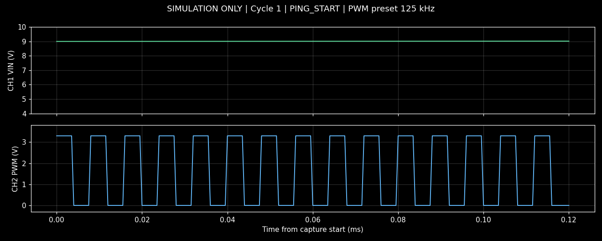
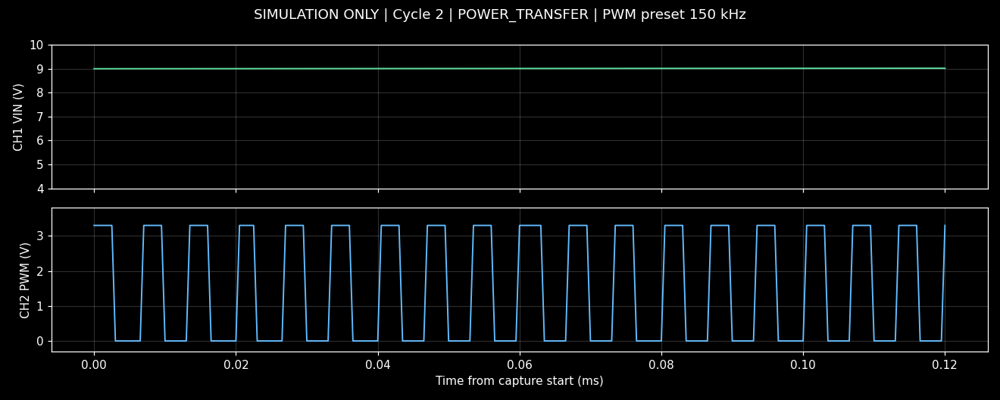
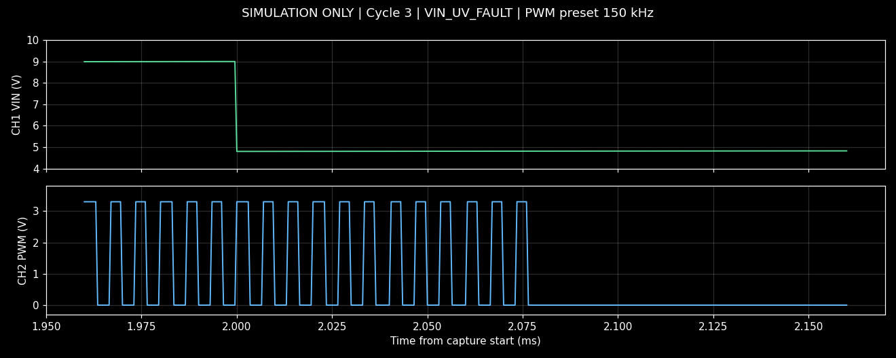

# 示波器/串口监控 · 模拟效果检查 · 总报告

| 项 | 值 |
|---|---|
| 作业指导 | WI-SCOPE-SERIAL-DEMO Rev SIM-1 |
| 工位 | SIM-STATION-001 / 离线演示工位（非实测） |
| 产品 | 无线充电器模拟样机 |
| 串口 | SIM-COM7（虚拟） @ 2000000 |
| 报告目录 | D:\\windlink\\windlink\\WiParse-R\\projects\\default\\tests\\ScopeSerialDemo\\runs\\20261013_231510\\artifacts\\reports |

每次触发追加一节；节名含轮次、触发条件和时间，记录 ID 与单份 PDF/ISF 文件名一致。

---

## 会话 SESSION-20261013_231510

| 项 | 值 |
|---|---|
| 启动时间 | 20261013_231510（模拟） |
| GUI | 1.1.29 |
| 示波器 | SIMULATED OSCILLOSCOPE id=SIM-SCOPE-001 |
| 触发规格 | PING_START / POWER_TRANSFER / VIN_UV_FAULT |

---

## 第 1 轮 · PING_START · 2026-10-13 12:00:01 (模拟)

**记录 ID：** `ScopeSerialDemo_PING_START_20261013_231510`

| 项 | 值 |
|---|---|
| 轮次 | 1 |
| 触发条件 | PING_START |
| 触发时间 | 2026-10-13 12:00:01 (模拟) |
| 命中行 | [SIM] [12:00:01.020] EVENT=PING_START PWM_HZ=125000 |
| 处理时串口 | monitoring=true |
| 示波器 | SIMULATED OSCILLOSCOPE id=SIM-SCOPE-001 |
| ISF | [ScopeSerialDemo_PING_START_20261013_231510.isf](../waves/ScopeSerialDemo_PING_START_20261013_231510.isf) |
| 截图 | [ScopeSerialDemo_PING_START_20261013_231510.png](../shots/ScopeSerialDemo_PING_START_20261013_231510.png) |
| PDF | 无 |

### 波形截图

### Log 上下文

~~~
[SIM] [12:00:01.000] RX_DETECT=1 VIN=9.00V
[SIM] [12:00:01.020] EVENT=PING_START PWM_HZ=125000 <<HIT>>
[SIM] [12:00:01.021] CAPTURE_REQUEST cycle=1
[SIM] [12:00:01.100] VIN=9.00V CAPTURE_OK=1
~~~

---

## 第 2 轮 · POWER_TRANSFER · 2026-10-13 12:00:02 (模拟)

**记录 ID：** `ScopeSerialDemo_POWER_TRANSFER_20261013_231510`

| 项 | 值 |
|---|---|
| 轮次 | 2 |
| 触发条件 | POWER_TRANSFER |
| 触发时间 | 2026-10-13 12:00:02 (模拟) |
| 命中行 | [SIM] [12:00:02.020] EVENT=POWER_TRANSFER PWM_HZ=150000 |
| 处理时串口 | monitoring=true |
| 示波器 | SIMULATED OSCILLOSCOPE id=SIM-SCOPE-001 |
| ISF | [ScopeSerialDemo_POWER_TRANSFER_20261013_231510.isf](../waves/ScopeSerialDemo_POWER_TRANSFER_20261013_231510.isf) |
| 截图 | [ScopeSerialDemo_POWER_TRANSFER_20261013_231510.png](../shots/ScopeSerialDemo_POWER_TRANSFER_20261013_231510.png) |
| PDF | 无 |

### 波形截图

### Log 上下文

~~~
[SIM] [12:00:02.000] RX_DETECT=1 VIN=9.00V
[SIM] [12:00:02.020] EVENT=POWER_TRANSFER PWM_HZ=150000 <<HIT>>
[SIM] [12:00:02.021] CAPTURE_REQUEST cycle=2
[SIM] [12:00:02.100] VIN=9.00V CAPTURE_OK=1
~~~

---

## 第 3 轮 · VIN_UV_FAULT · 2026-10-13 12:00:03 (模拟)

**记录 ID：** `ScopeSerialDemo_VIN_UV_FAULT_20261013_231510`

| 项 | 值 |
|---|---|
| 轮次 | 3 |
| 触发条件 | VIN_UV_FAULT |
| 触发时间 | 2026-10-13 12:00:03 (模拟) |
| 命中行 | [SIM] [12:00:03.020] EVENT=VIN_UV_FAULT PWM_HZ=150000 |
| 处理时串口 | monitoring=true |
| 示波器 | SIMULATED OSCILLOSCOPE id=SIM-SCOPE-001 |
| ISF | [ScopeSerialDemo_VIN_UV_FAULT_20261013_231510.isf](../waves/ScopeSerialDemo_VIN_UV_FAULT_20261013_231510.isf) |
| 截图 | [ScopeSerialDemo_VIN_UV_FAULT_20261013_231510.png](../shots/ScopeSerialDemo_VIN_UV_FAULT_20261013_231510.png) |
| PDF | 无 |

### 波形截图

### Log 上下文

~~~
[SIM] [12:00:03.000] RX_DETECT=1 VIN=9.00V
[SIM] [12:00:03.020] EVENT=VIN_UV_FAULT PWM_HZ=150000 <<HIT>>
[SIM] [12:00:03.021] CAPTURE_REQUEST cycle=3
[SIM] [12:00:03.100] VIN=4.80V FAULT=UV PWM=OFF
~~~

---

## 模拟场景说明与原始数据

**本报告全部内容为离线合成数据。未连接串口或示波器，不代表产品实测或合格结论。**

三轮分别演示 PING、正常功率传输和 VIN 欠压后的 PWM 关闭。频率和动作时序为预设值，未执行实测指标判定。PDF 未生成。

- [完整串口日志](../docs/serial-monitor.log)
- [采集记录与模拟参数](../docs/capture-records.json)
- 第 1 轮 [原始 CSV 数据](../waves/ScopeSerialDemo_PING_START_20261013_231510.csv)
- 第 2 轮 [原始 CSV 数据](../waves/ScopeSerialDemo_POWER_TRANSFER_20261013_231510.csv)
- 第 3 轮 [原始 CSV 数据](../waves/ScopeSerialDemo_VIN_UV_FAULT_20261013_231510.csv)
